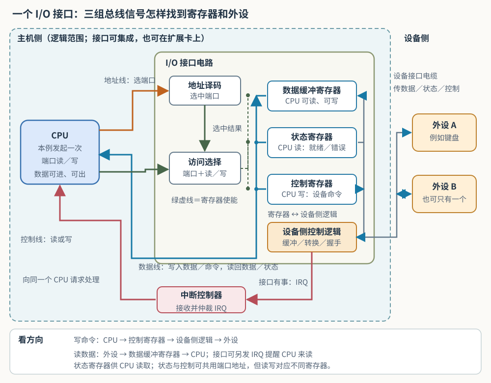

<!--twopane
page: 7.2-7.3 I-O接口与方式（两栏·点开即用）.html
① I/O 接口的实际结构与信号线 | ../images/io_interface.svg
② 地址、寄存器、IRQ 实际怎么走 | ../OS/计组-IO接口-寄存器与信号-交互演示.html
③ 中断九步、嵌套与屏蔽字 | ../OS/中断与异常-交互演示.html
④ I/O 接口的四种分类轴 | ../images/io_interface_types.svg
⑤ I/O 端口：独立编址与 MMIO | ../images/io_address_spaces.svg
⑥ 程序查询：六步循环与三字节实例 | ../images/io_polling_loop.svg
⑦ 程序查询与中断：CPU 时间线 | ../OS/计组-程序查询与中断-时间线.html
⑧ DMA 控制器：配置到完成 | ../OS/计组-DMA控制器-配置搬运完成.html
⑨ DMA：许可、计数与循环 | ../images/dma_permission_loop.svg
⑩ DMA 三种访存：同一时间轴 | ../OS/计组-DMA三种访存-时间线.html
⑪ 共享总线与 PCIe：线路和交换芯片 | ../images/bus_shared_vs_pcie.svg
⑫ 现代主板：设备、插槽与连线 | ../images/board_physical.svg | fit=width
⑬ USB 硬盘盒：SATA 数据与供电两条路 | ../images/sata_usb_enclosure.svg
-->
# 计算机组成原理 · I/O系统 完整整理笔记

> 本笔记按知识的内在逻辑顺序组织，覆盖 I/O 接口 → 程序查询 → 程序中断 → DMA → 总线/PCIe 这条完整链路。

---

## 目录

1. I/O接口是什么、为什么需要
2. I/O接口的内部结构（图7.1）
3. 地址译码、I/O控制逻辑、寄存器访问控制逻辑的精确分工
4. 端口、接口、控制器、适配器：几个容易混的词
5. 中断请求的物理传递路径（以键盘为例，走到底）
6. I/O接口的类型（并行/串行、查询/中断/DMA、可编程/不可编程）
7. I/O端口编址（独立编址 vs 统一编址，及现状）
8. 程序查询方式
9. 程序中断方式（完整机制）
10. DMA方式
11. 总线：从共享总线到PCIe
12. 现实硬件案例：SATA、USB硬盘盒
13. CPU微观执行机制补充（时钟周期、流水线、控制器电路）
14. 学习心得

---

## 1. I/O接口是什么、为什么需要

计算机内部，CPU和外设之间存在三种根本性差异：

- **工作方式不同**：键盘是"一次给一个字节"（字符方式），硬盘是"一次给一整块"（块方式）。
- **数据格式不同**：麦克风给出连续变化的模拟电压，CPU只认0/1数字信号，需要A/D转换；反之D/A转换。
- **工作速度不同**：CPU纳秒级，外设（如打印机）毫秒级甚至更慢，相差可达百万倍。

**I/O接口（I/O控制器）** 就是夹在CPU和外设中间，专门弥合这三种差异的电路：
- 用**数据缓冲寄存器**解决"节奏不合拍"；
- 用**转换电路**解决"语言不通"（信号格式转换）；
- 用**握手信号**解决"谁先说话"（通信联络）。

**接口的物理位置**：接口 = "看得见的插孔（连接器）" + "看不见的电路（真正的接口芯片/控制电路）"。你摸到的USB口只是连接器；真正干活的是主板上（或整合进芯片组里）一块专门的芯片。

**这三个寄存器（以及地址译码、I/O控制逻辑）以前是不是也做成独立插卡？现在焊在哪**：老式PC上，这些接口电路,常常做成一块独立插卡，插在主板的扩展槽里（比如曾经的声卡、网卡、打印机适配器卡，都是这么插上去的，物理上是独立于主板的一块小电路板）。**现在，这些电路，大多被直接焊死、整合进了主板本身或者芯片组内部**，不再是插卡形式。原因：
- 芯片制造工艺进步（摩尔定律），原本需要多颗芯片实现的功能，现在能塞进一颗芯片；
- 省成本、省空间、走线更短，速度更快更稳定；
- 但不是所有接口都整合了——独立显卡这种运算量大、数据吞吐量大的，依然需要单独一块卡。

### I/O接口的五大功能（7.2.1）

1. **地址译码与设备选择**：CPU发出I/O操作请求时，会同时给出目标外设的地址码。接口内部的地址译码电路收到这个地址后，与自己出厂就"焊死"认定的固定编号比对，一致才产生设备选择信号、响应这次操作。这保证了总线上挂着键盘、鼠标、打印机十几个设备时，CPU一次只会精确地"叫醒"其中一个，不会互相干扰。
2. **通信联络与时序协调**：CPU和外设的工作速度差距悬殊（CPU纳秒级，打印机毫秒级，能差上百万倍），接口靠握手信号（如一方发出"数据已就绪"的选通脉冲，另一方回应"已收到、可以发下一个"）或状态轮询（CPU反复查询状态寄存器确认外设是否就绪），协调双方各按自己的节奏工作，不需要谁去死等谁。
3. **数据缓冲**：接口设有数据缓冲寄存器，充当CPU和外设之间的暂存格。外设按自己的节奏把数据放进这个格子，CPU按自己的节奏来取，双方不用同步；如果没有这个中转格，数据来得快、CPU来不及取，就会被直接覆盖丢失（即"溢出"）。
4. **信号格式转换**：主机与外设在电平标准、数据格式上可能完全不兼容，接口需要完成电平转换（如把外部±12V的RS-232信号转成内部的TTL 0/5V电平）、并/串或串/并转换（把内存里并行组织的一个字节，拆成一位一位串行发送，或反过来拼回来）、模/数或数/模转换（如麦克风送来的连续电压，转换成CPU能处理的一串0和1）。
5. **控制命令与状态信息传递**：CPU通过向接口的控制寄存器写入命令字（如写入一个具体的二进制数，含义是"启动打印"）来控制外设；外设通过状态寄存器反馈状态（如某一位置1表示"就绪"）供CPU查询。当外设需要主动通知CPU（如数据已经到达，不想让CPU一直傻等着来查），接口可以向CPU发出中断请求，由CPU适时响应处理——这就是后面要讲的"程序中断方式"的雏形。

操作系统一侧讲设备控制器时，常把功能列成六项：**接收和识别命令**（如磁盘控制器能响应 CPU 发来的读、写、寻道命令）、**数据交换**（CPU 与控制器之间、控制器与设备之间）、**标识和报告设备状态**（供 CPU 查询与处理）、**地址识别**、**数据缓冲**、**差错控制**。前五项和上面五大功能是同一件事的不同切法；**差错控制**是多出来的一项：控制器检查从设备读出或送往设备的数据有没有出错（例如磁盘控制器用每个扇区附带的校验码核对读出的数据），出错就在状态寄存器里置错误位、报告 CPU。

---

## 2. I/O接口的内部结构（图7.1）

【左栏 1】

图7.1描述的通用I/O接口结构分为**主机侧（系统总线）**和**设备侧（接口电缆）**两部分：

这张图补充了三点，原图容易漏掉：
1. **这张图画的是 CPU 主导的一次 I/O 访问**：CPU 发出目标端口地址与读/写控制信号；写操作时数据由 CPU 发出，读操作时数据则由接口沿数据线返回 CPU。DMA 获得总线使用权后还可以由 DMAC 发出地址和写控制信号，见第 10 节。
2. **地址译码和寄存器访问控制逻辑，是两块不同的电路**（第3节详细讲了这层区分）——地址译码只认地址线、产生"选中信号"；寄存器访问控制逻辑接收选中信号和读写方向，决定放行数据到哪个寄存器。
3. **中断判优不在这个外设接口的三类寄存器里**——接口发出“有情况”的 IRQ，再由中断控制器汇总、仲裁并通知**同一个** CPU。图中把中断控制器单独画出，是逻辑分工；现实实现可以是独立芯片，也可以集成在处理器或芯片组中。

### 完整走一遍：发送方向和接收方向，各自沿图上哪些边走

【左栏 2】

图中蓝色数据线可双向传输，地址线、一次端口访问的读／写控制、选中与使能信号则有明确方向；设备侧的具体数据、状态和控制路径视接口实现而定。状态与控制画成不同的物理寄存器：两者在某些接口里**共用端口地址**，并非一个存储格在读写时变身。下面把两个数据方向各走一遍；逐步信号变化另见左栏②。

**发送方向一：CPU把数据发给外设（比如往打印机发一个字符）**

①CPU同时发三路信号——地址线给地址译码；控制线说明这次是“写”；数据线把字符送向接口（这条线双向，这次走“CPU→寄存器”方向）。②地址译码确认目标端口后，访问选择逻辑结合端口和写方向，使能数据缓冲寄存器。③字符锁存进缓冲寄存器。④设备侧控制逻辑按接口协议取出字符、转换成电缆信号，并与外设握手。⑤字符送达外设。图中的绿虚线表示**寄存器使能**，不是另有一条“把字符送到外设”的数据线。

**发送方向二：CPU发命令字给外设（比如"启动打印机"，走的是控制寄存器，不是数据缓冲寄存器）**

①CPU给出控制端口的地址、写控制和命令字。②地址译码与访问选择逻辑使能**控制寄存器**；若这个端口地址与状态寄存器共用，写方向使访问落在控制寄存器，读方向才会落在状态寄存器。③命令字（如`0000 0001`）锁存到控制寄存器。④设备侧控制逻辑按接口时序解释命令，转换成电缆信号（如启动脉冲），外设据此动作。**命令与普通数据共用主机侧数据线，落点和设备侧解释却不同。**

**接收方向：外设把数据发给CPU（比如按下键盘一个键）**

①外设把原始信号交给设备侧控制逻辑。②控制逻辑整理后写入数据缓冲寄存器，并更新状态寄存器的“新数据就绪”位。③若采用中断方式，接口发出 IRQ；中断控制器仲裁后通知**同一个** CPU。④CPU运行服务程序，以端口地址和“读”控制重新访问接口；访问选择逻辑使能数据缓冲寄存器，接口沿双向数据线把数据返回 CPU。以独立编址的键盘端口为例，服务程序可执行 `IN`；统一编址接口则用相应的访存指令。

**一句话总结**：发送方向是“CPU→寄存器→设备侧逻辑→外设”；接收方向是“外设→设备侧逻辑→数据缓冲寄存器→CPU”。IRQ 是另外一条**通知路径**，提醒 CPU 之后发起读操作，本身不搬运那份数据。

**主机侧三类寄存器**：
- **数据缓冲寄存器**：暂存CPU与外设间传送的数据，可读可写。
- **状态寄存器**：记录接口及外设当前状态，**只能被CPU读**（因为这个信息是"外设往上汇报"，方向天然是单向的）。
- **控制寄存器**：保存CPU发给外设的控制命令，**只能被CPU写**（"CPU往下发命令"，方向也天然单向）。

由于状态寄存器只读、控制寄存器只写，访问方向相反、时间错开，某些设计中可复用同一个端口地址——**读操作访问状态，写操作访问控制**（经典例子：8042键盘控制器的0x64端口）。

**记忆口诀**：状态是"汇报"，往上走，CPU只能读；控制是"命令"，往下走，CPU只能写。

**数据线、地址线、控制线各自传什么**：
- **数据线**：传读/写数据、状态信息、控制信息，以及中断类型号（向量中断中）。
- **地址线**：指定要访问I/O接口内部哪个寄存器的端口地址。
- **控制线**：传读/写控制信号（区分寄存器访问方向）、中断请求与响应信号、总线仲裁信号、设备握手信号。

**从组成上看，一个设备控制器有三部分**：①**与 CPU 的接口**，就是上面这三类线连进来的那一侧；②**与设备的接口**，一个控制器可以连一台或多台设备（如一个磁盘控制器接两块盘），所以内部有一个或多个设备接口，每个都传送数据、控制、状态三类信号；③**I/O 逻辑**，对收到的 I/O 命令译码，并按地址找到要控制的那台设备——CPU 启动设备时，把启动命令和目标地址一起发给控制器，由 I/O 逻辑解析后控制指定的设备。教材图 7.1 用省略号表示接口可有多个设备侧端口；本笔记左栏①画了两个示意外设，实际数量由控制器决定。

### 寄存器有多大？装不装得下大数据？

图 7.1 只表示寄存器的功能，不规定它们都恰好是 1 字节。以一次存 1 字节的简单串口接口作例子，单个数据寄存器是一个很小的暂存格；不同设备可以有更宽的寄存器和更大的 FIFO／缓冲存储区：

- **面对大块数据**（如硬盘一个扇区 512 字节）：接口可先把数据放进自己的缓冲区，再用 **DMA** 在设备与主存间按批传送，CPU 不必逐字节读写数据端口。
- **面对源源不断的小数据流**（如老式串口）：如果CPU来不及取，旧数据会被覆盖或丢弃，这叫**溢出错误（Overrun）**。
- **现代改进**：现代芯片常在1字节接口背后藏一个更大的**FIFO队列**（如16550串口芯片的16字节FIFO），让数据先排队缓冲，缓解但不根除这个问题。

### 三个寄存器，哪些能合并？现实怎么做？

- **状态寄存器 + 控制寄存器**：最常见的合并方式（图7.1画法），共用一个端口地址，靠"这次是读还是写"自动区分（8042键盘控制器的0x64就是典型例子）。硬件上靠一个选择器（多路复用器），根据读写方向信号，把总线接到状态寄存器输出，或者接到控制寄存器输入。
- **数据缓冲寄存器**：一般单独占一个地址（因为访问频率最高，不适合再加模式切换的复杂度）。但更复杂的芯片（如16550 UART）也会把数据寄存器按方向拆成"接收缓冲寄存器"和"发送保持寄存器"，合用一个地址；甚至引入DLAB位这种"模式开关"，让同一地址在不同模式下指向完全不同的寄存器组（用于配置波特率）。

### "锁存"：为什么CPU写入命令的信号是瞬间的，但命令内容能一直保持？

CPU执行写指令时，控制线上的写选通信号（WR）只是一个极短暂的电脉冲（几十纳秒），脉冲结束后信号线上什么痕迹都不留。但这个脉冲会触发寄存器内部的**触发器**，在脉冲边沿把当时数据线上的值"拍照"式地**锁存**下来，稳定保持，直到下一次写操作发生才会被替换。这就是为什么"通知"是转瞬即逝的，但"通知的内容"却是持久保存的。

---

## 3. 地址译码、I/O控制逻辑、寄存器访问控制逻辑的精确分工

图7.1里"地址译码和I/O控制逻辑"实际上是**两块甚至三块**功能不同的电路合并画在了一个框里，理清楚这三块，才能理解一次CPU写命令的完整链路：

### 第一块：地址译码

- **输入**：只接收地址线传来的二进制数字（如0110 0000，即0x60）。
- **动作**：与自己出厂就"焊死"认定的一个固定二进制组合比对，一致才响应。
- **输出**：一个简化的"选中信号"，指向"是哪个端口被选中"这个结论——**不会把原始地址数字继续往下传**。

这里的关键点是：**地址不是存储的数据**，而是"接口电路,是否只认某一个固定二进制信号组合"这个电路设计事实本身。硬件上靠与门/非门连线实现，某些老设备用跳线/DIP开关，改变译码电路里某几路信号是否经过非门，从而改认另一个地址。

**地址译码其实包含两层不同粒度的判断，容易被当成一回事**：

- **外层（芯片级/设备级译码）**：总线上可能同时挂着键盘接口（8042）、串口接口、打印机接口好几块独立芯片，每一块出厂时就被焊死认一个属于自己的地址范围（比如8042只认0x60和0x64附近，串口认0x3F8附近）。CPU发出地址后，每一块芯片各自有一个比较器电路，先判断"这个地址是不是落在我的范围里"——只有落在自己范围里的那一块芯片才会响应，其余芯片置身事外。**这一层，才是真正意义上"选发往哪个接口/适配器"的那道关卡。**
- **内层（芯片内部/端口级译码）**：确认"是这块芯片"之后，芯片内部还要再做一次更细的比较（比对地址的具体某几位），才能确定这次落在芯片自己拥有的哪一个具体端口（比如8042内部，还要再区分是0x60还是0x64）。**前面举的键盘例子、以及之前反复用过的"地址译码判断是不是在叫我"，讲的其实一直是这一层**——已经预设"外层那道'是不是8042'的判断已经通过"，聚焦在单独一块接口芯片内部去讲，没有专门画出"总线上还有别的芯片、外层还有一道筛选"这个更大背景。

两层都叫"地址译码"，只是判断对象、发生的物理位置不一样：外层发生在总线上，决定选中哪块芯片；内层发生在芯片内部，决定选中这块芯片里的哪个端口。

### 第二块：寄存器访问控制逻辑（容易被误称为"I/O控制逻辑"，需要单独区分）

- **输入**：地址译码给的选中信号 + 控制线的读写方向信号。**不直接接触地址线原始数据**。
- **动作**：根据"选中的是哪个端口 + 这次是读还是写"，决定放行数据线内容写入哪个寄存器，或者把哪个寄存器内容放上数据线。
- 工作对象是"总线和寄存器之间"，服务CPU这一侧，不需要知道外设是什么。

**为什么不能把数据／地址／控制线直接接进寄存器**：内存芯片本来也需要地址译码、片选和读写使能。I/O 接口同样要先由地址译码选中目标，再由访问控制电路依据读写方向使能相应寄存器；即使每个寄存器都有独立地址，这些读写使能仍然需要。**共用端口地址时还要多做一项选择**：例如 0x64 的读操作访问状态寄存器，写操作访问另一只物理上的控制寄存器。此时地址本身不足以唯一确定寄存器，必须结合读／写信号。左栏①把三只寄存器分开画，绿虚线表示访问选择电路给寄存器的使能。

### 第三块：I/O控制逻辑（严格意义，7.2.1原文真正定义的那个）

- 工作对象是"寄存器和外设/电缆之间"的转换，**完全不关心CPU那一侧的地址、读写方向**。
- 具体四件事（两两方向相对）：
  1. 把控制寄存器命令字翻译成电缆信号（寄存器→外设）
  2. 把数据缓冲寄存器要输出的内容转成电缆信号（寄存器→外设）
  3. 把外设传来的原始信号整理写进数据缓冲寄存器（外设→寄存器）
  4. 实时感知外设状态更新进状态寄存器（外设→寄存器）
- 这一块，正是它把命令字转换成电缆上具体的电平变化（如STROBE选通脉冲），"通知外设该收数据了"。外设处理完再通过BUSY/ACK反馈"我好了"——这套完整的"数据摆好→脉冲通知→对方处理完反馈"就是**握手机制**的具体实现。

### 一条完整链条（CPU写命令字"启用键盘"0xAE 到端口0x64）

| 站点 | 位置 | 接收 | 输出 |
|---|---|---|---|
| CPU发指令 | CPU内部 | — | 同时送出地址线(0110 0100)、数据线(1010 1110)、控制线(写) |
| ①地址译码 | 接口芯片内 | 只接地址线 | "选中信号"（指向控制端口） |
| ②寄存器访问控制逻辑 | 接口芯片内 | ①的选中信号+控制线 | 允许写入使能信号；数据线原始值直接搭桥送到③ |
| ③控制寄存器 | 接口芯片内 | 数据线原始值+②的使能 | 锁存保存0xAE |
| ④I/O控制逻辑（执行侧） | 接口芯片内 | 主动读取③内容 | 翻译成电缆信号格式 |
| ⑤键盘 | 外设本体 | 电缆信号 | 执行"启用"动作 |

---

## 4. 几个容易混的词：端口 / 接口 / 控制器 / 适配器

- **接口**：一整块电路模块（如"键盘接口"），包含数据/状态/控制三个寄存器+译码电路+控制逻辑。
- **端口**：接口内部，CPU能直接寻址访问的**每一个具体寄存器**。一个接口通常包含好几个端口（数据端口、状态端口、控制端口）。
- **控制器（Controller）**：和"接口"基本是同一类东西，只是更强调"承担主动管理、调度角色"，常用于功能相对复杂的场景（USB控制器、网络控制器、可编程中断控制器——就是第5节要详细讲的、负责汇总多个设备中断请求并转告CPU的那块独立芯片，如8259A/APIC，"可编程"是因为它内部的映射表、屏蔽字这些配置,可以由软件写入改变）。
- **适配器（Adapter）**：历史上常用来称呼**独立插卡形式**的接口电路（如打印机适配器卡、显示适配器卡）。

这三个词在绝大多数语境下可以互换，都指"主机和某个外部功能之间负责协调通信的一整块电路"。

### 外设本身是否也有自己的电路？

**是的**。外设本身（如键盘内部的小芯片）也有电路和寄存器。对 **USB 键盘**，CPU 直接访问的是主机侧 USB 控制器的寄存器；键盘内部寄存器不能当作普通 CPU 端口地址直接读写，双方靠 USB 协议交换请求与数据。**但不能把“CPU 可寻址的设备寄存器都焊在主板上”当通则**：PCIe 网卡、显卡等端点的寄存器可位于扩展卡／设备本体，系统通过 BAR 把它们映射进 CPU 的 I/O 或内存地址空间。见 [Linux 内核 PCI BAR 映射接口](https://docs.kernel.org/driver-api/pci/pci.html)。

### USB接口：不同设备走的是同一套硬件

同一个 USB 主机控制器可以管理不同 USB 设备；主机控制器电路在主机侧，每个 USB 设备自己也有端点和控制电路。**“共用主机控制器”不等于所有设备共用同一只数据寄存器、硬件完全不区分设备。**控制器按设备地址和端点处理传输；设备插入后，主机软件通过枚举取得设备描述符，操作系统再选择相应驱动。传输的调度由控制器硬件执行，设备的用途和上层数据含义主要由软件解释。

### 一个具体例子：网络适配器（网卡），把前面几个概念全部对应一遍

**"网络适配器"就是"网卡"（Network Interface Card，NIC）的另一种叫法**——负责连接主机和网线（或WiFi信号）之间的一整块接口电路，功能定位跟键盘接口是同一类角色，只是服务的外设从键盘换成了网络。

**内部结构，跟图7.1的框架完全对得上，只是规格被放大了**：
- **数据缓冲寄存器**：网络数据包动辄几百上千字节，远超1字节的小格子能装，所以现实中网卡这一块通常是一整块更大的专用缓冲存储区（不是单个1字节寄存器），但功能定位依然是"数据缓冲寄存器"这个角色。
- **状态寄存器**：记录"网线有没有插好""有没有收到新数据包"等状态。
- **控制寄存器**：CPU写命令字进去，比如"开始发送这个数据包"。
- **I/O控制逻辑**：网卡要做的"信号格式转换"比键盘复杂得多——除了基本电平转换，还要处理网络协议规定的组帧、校验、寻址这一整套逻辑，这也是"网络控制器"这个词更常被单独强调出来的原因（承担了比简单接口更复杂的协议处理工作）。

**中断投递由网卡和平台共同完成**：教材式并行总线可画成“网卡拉 IRQ 线→平台中断控制器→CPU”；现代 PCIe 网卡常用 MSI/MSI-X，向指定中断目标地址发写事务，不必为每个中断向量各拉一根专线。CPU 最终仍经平台／处理器的中断处理硬件收到请求。左栏①画的是前一种便于入门的逻辑路径，不代表所有网卡的实际走线。

**网卡驱动是什么**：驱动是运行在 CPU 上的软件，负责配置网卡、提交收发缓冲区、处理完成通知并把收到的包交给内核网络栈。现代 PCIe 网卡通常通过 **MMIO 寄存器**与驱动交换命令和状态，包数据由网卡的 DMA 功能写入主存中的接收缓冲区；驱动不会靠反复执行 `IN` 指令逐字节把整包搬进内存。若缺少合适的驱动，硬件可能仍通电并感知链路，但操作系统无法按该设备的寄存器和队列协议正常完成收发。

**网卡硬件和OS内核，各自对应网络分层模型里的哪几层**：按经典TCP/IP五层模型对应：

| 层级 | 谁负责 | 运行位置 |
|---|---|---|
| 应用层 | 应用程序自己 | 用户态 |
| 传输层（TCP/UDP） | OS内核网络协议栈 | 内核态 |
| 网络层（IP） | OS内核网络协议栈 | 内核态 |
| 数据链路层 | 网卡的**MAC控制器** | 硬件 |
| 物理层 | 网卡的**PHY芯片** | 硬件 |

- **物理层——PHY芯片**：负责最原始的信号转换——把内存里的数字数据（0/1）转成网线上的电信号/光纤上的光信号，反之亦然。这正对应I/O控制逻辑里"信号格式转换"这个基础功能，只是这次转换的是数字数据↔物理线路信号这一层。
- **数据链路层——MAC控制器**：负责把要发的数据按以太网协议组装成"帧"（加源/目标MAC地址、校验码），接收时反过来拆帧、校验。这也概念上属于I/O控制逻辑这个角色，只是承担的转换工作比简单接口复杂得多（多了组帧、寻址、校验这套协议逻辑），这也是"网络控制器"这个词被单独强调出来的原因。
- **传输层和网络层**——都由OS内核的网络协议栈负责，运行在内核态（因为要直接操作网卡硬件、管理全系统共享的网络资源，用户态程序没有权限直接做这些事）；TCP要处理三次握手、序号确认、超时重传这一整套连接管理，UDP相对简单，主要是端口号分发。
- **驱动程序**卡在数据链路层和网络层之间——它不是某一层协议本身，而是衔接MAC控制器和内核网络协议栈的中间人：中断处理函数把MAC控制器已拆好的帧，从缓冲区交给内核协议栈，协议栈再一层层剥开处理（先剥MAC帧头交给IP层，IP层再剥IP头交给TCP/UDP层）。

**现状补充：协议卸载（Offload）**——现代高端网卡会把一部分本该内核软件完成的工作，也做成硬件电路自己完成（比如TCP校验和计算、大数据包分段TSO），内核只需把没切好的大块数据交给网卡，网卡自动切好、加上校验再发出去——这跟DMA"把CPU该做的重复劳动转交给专用硬件"是同一个思路，只是这次是网卡"越界"帮内核分担了一部分，不再是教科书上"网卡只管物理层+数据链路层"这么干净利落的分工。

### 另一个例子：显卡和"显示控制器"是什么关系

**"显示控制器"是"显卡"这块板子里的一部分，不是整块显卡的另一种叫法**——严格说，显卡打包了两种角色完全不同的电路：

- **GPU（图形处理器）**：负责真正的"计算"，把游戏画面、光影效果通过大量并行运算,算出屏幕上每个像素点该显示什么颜色——这一块的角色更接近"运算单元"，跟I/O接口框架关系不大。
- **显示控制器**：才是真正对应I/O接口这套框架的部分——把GPU算好的画面数据转换成HDMI、DisplayPort这类接口标准规定的信号格式，送到显示器。它内部有一块存放"待显示画面数据"的缓冲区（在显卡里的具体名字叫**显存中的帧缓冲区**），以及负责协调时序的控制逻辑（按显示器要求的刷新率，比如每秒60次或144次，把一整帧画面按固定节奏送出去）。

**一个类比**：GPU像画室里的画家，负责把每一帧画真正画出来；显示控制器像快递站的调度员，不负责画画，只负责把画家已经画好的画，按客户（显示器）要求的规格（分辨率、刷新率、接口协议）打包好、按固定节奏发出去。日常说的"显卡"是把这两个角色打包在同一块板子上一起卖，但严格说"显示控制器"只对应"快递站"这部分。

**现状**：现在很多CPU（如Intel酷睿、AMD锐龙大多数型号）内部直接集成了一颗小型GPU（俗称"核显"），显示控制器这部分电路也跟着一起整合进了CPU芯片内部,不需要额外买显卡插卡——这跟USB控制器整合进芯片组是同一个演变逻辑：日常办公、看视频这类不需要极致性能的场景，用CPU自带的核显+显示控制器就够；只有需要顶级图形性能（3A游戏、专业渲染）才需要额外插一块独立显卡，图的是那颗更强大的GPU。

---

## 5. 中断请求的物理传递路径（以按下键盘"A"键为例，走到底）

> **模型范围**：下文先用老式键盘控制器＋8259A 的**引脚式 IRQ／INTR** 解释教材流程；不同主板可改用 APIC、MSI/MSI-X 或 USB 主机控制器，硬件位置、请求保持方式和类型号投递方式会变。图中的“独立线”与“控制器芯片”不可直接套到所有现代设备。第 11 节另画 PCIe 拓扑。

【左栏 3】

👉 **[打开交互演示：中断与异常，一步一步走一遍](../OS/中断与异常-交互演示.html)**（外中断、缺页、系统调用、违规与终止、多重中断与屏蔽字，五个场景，← / → 方向键逐步播放）

下面把这个过程,拆成完整的一条时间线：

### 第一步：键盘接口芯片内部（设备接口/适配器）

- 键盘产生扫描码（如0x1E），经I/O控制逻辑整理拼装，写入**数据缓冲寄存器**。
- I/O控制逻辑同步更新**状态寄存器**（如第0位置1，表示"有新数据未取走"）。
- 这一切，全部发生在键盘接口芯片（如8042）内部，此时CPU完全不知情，仍在执行别的程序。

### 第二步：键盘接口芯片发出中断请求

- 数据存好后，接口电路通过专门的**中断请求线（IRQ）**发出电信号。具体采用边沿触发还是电平触发、何时撤销请求，由接口与中断控制器的设计决定，不能统一写成“持续拉高直到 CPU 取走数据”。
- **在此经典模型中**，IRQ 送到中断控制器而非直接进入 CPU 的 INTR 输入：8042 的请求接到 8259A 的某个输入引脚（如 IR1），由控制器汇总后通知 CPU。现代 USB 键盘的通知由 USB 主机控制器及平台中断机制处理，不是键盘各自接一根线到 8259A。

### 第三步：中断控制器汇总、仲裁、产生类型号

- 中断控制器内部有一份**"引脚→中断类型号"的映射表**（这份表是系统启动阶段，由BIOS/操作系统通过`OUT`指令写进中断控制器配置寄存器的，**不是硬件出厂焊死的**，也**不是键盘自己决定的**——键盘从始至终不知道、也不需要知道自己被分配了哪个类型号）。
- 如果多个中断源同时请求，中断控制器内部的**硬件排队器**按固定的响应优先级（如A>B>C>D，由硬件电路连线决定）挑出一个。
- 中断控制器通过**INTR**这根线，告知CPU"有请求"。

### 第四步：CPU响应，中断隐指令自动执行

CPU满足以下三个条件才会响应：
1. 存在有效的中断请求；
2. CPU处于开中断状态（IF=1，**异常和NMI不受条件②限制**）；
3. 当前指令已执行完毕（**只有异常不受条件③限制**，NMI依然要等），且无更高优先级任务待处理。

**注意 NMI 不受 IF 屏蔽，但也要在可接纳的指令边界进入。**它不在一条已开始执行的普通指令中间任意改写程序状态；等待当前指令、处理器接纳请求和完成入口动作都需要时间，不能推成“最多几纳秒”。故障类异常与当前指令相关，可能让该指令不能正常完成；不要把异常和外部中断混成同一响应时机。参见 [Intel 架构手册的 NMI 与指令边界说明](https://cdrdv2-public.intel.com/825758/253668-sdm-vol-3a.pdf)。

**为什么按指令边界交付外部中断**：教学模型可理解成“当前指令结束，再转入服务程序”；现代乱序处理器可提前取指、执行后续指令，但按程序顺序提交结果，外部中断在可恢复的指令边界交付。这里说的是**程序可见的交付点**，不是断言硬件只在那一瞬间读取一次请求引脚，更不要求下一条指令从未被提前取到。这样保存的断点和体系结构状态才一致。参见 [Intel 手册关于 retirement 阶段的说明](https://cdrdv2-public.intel.com/825758/253668-sdm-vol-3a.pdf)。

**还有一层容易漏掉的开关：外设接口自己的"中断允许触发器"，跟IF、屏蔽字都不是同一个东西**——完整算下来，一个中断请求要真正被CPU响应，实际上要闯过三道关：
- **外设接口里的"中断请求触发器"**：外设有请求时置1，用来维持/记录这个请求信号（前面讲过的中断请求标记寄存器，就是这一层）。
- **外设接口自己的"中断允许触发器"**：这是一个独立的开关，位于接口本身（不是CPU的IF，也不是中断控制器里的屏蔽字），必须为1，这个接口发出的中断请求信号才会真正被送出去、传到中断控制器/CPU那一侧——如果这个接口自己的允许位是0，哪怕它内部的请求触发器已经置1了，这个请求也出不了这块接口芯片，中断控制器压根看不到它。这一位通常由驱动程序在初始化设备时设置（"我允许这个设备发起中断"）。
- **CPU内部的IF（中断屏蔽触发器）**：全局总开关，前面反复讲过。

三层缺一不可：接口自己的允许位得开，请求信号才能送出接口；送到中断控制器之后还要看屏蔽字有没有把它筛掉；最后CPU这边IF还要是开的。

响应发生后，硬件自动执行"中断隐指令"（不是ISA里能写出来的一条汇编指令，而是CPU控制器内部一段硬件写死的固定微操作序列，从触发那一刻起就脱离了"正常指令、逐条采样中断"这个框架，因此天然不会被中断打断）：

1. **①关中断**：把IF清0。
2. **②保存断点**：把PC（和PSW）存入栈或专用寄存器。
3. **③中断服务程序寻址**：CPU通过总线向中断控制器发出"中断确认(INTA)"信号，中断控制器把之前查表得到的**中断类型号**（如9），通过**数据总线**发送给CPU；CPU据此计算出中断向量在中断向量表中的地址，读出向量（服务程序入口地址），送入PC。**"向量"本质上就是"指针"的另一种叫法**——都是"存着一个地址值、指向别处"的一个数据，只是"向量"这个词是计算机体系结构领域较早独立发展出来的说法（借用数学"向量"一词里"指引方向"这层隐喻），"指针"则是后来在C语言这类编程语言里更常用的叫法，两者描述的是同一类机制，没有本质区别，不用把它们当成两种不同的东西。

**这一步（引出中断服务程序）软硬皆可,历史上有两种实现方式,现代普遍走的是硬件向量法**：
- **硬件向量法**（上面描述的这套，也是现代绝大多数系统的做法）：CPU响应中断后，硬件直接根据中断类型号查表、算出真正的服务程序入口地址，一步到位送入PC，整个过程不需要任何软件参与，①②③全部属于中断隐指令。
- **软件查询法（非向量中断，老式系统曾用过，现在很少见）**：CPU响应中断后，PC先跳到一个固定、预先写死的"通用查询程序"入口（这个地址不需要现场计算，硬件依然要负责这次跳转，因为软件此刻还没开始运行，没法自己完成跳转），再由这段软件代码依次查询每个可能的中断源（挨个读它们的状态寄存器,问"是不是你在请求"），确认是谁之后再自己跳转到真正的服务程序。这种方式效率较低（要一个个问，越靠后被查到的设备等待越久），电路更简单，但因为现代系统普遍已经用了向量中断（硬件向量法或MSI这类更先进的变体），软件查询法基本被淘汰。
- **两种方式的界限在于"谁去确定真正服务程序的入口地址"**：硬件向量法这一步完全是隐指令；软件查询法里，硬件只负责跳到通用查询程序入口，"确定真正入口在哪"转交给软件，不算隐指令的一部分。

> **注意**：中断请求信号走的是I/O总线的控制线（专门的IRQ线）；中断类型号走的是数据总线，是中断响应阶段由中断控制器提供给CPU的——两者物理路径完全不同。中断类型号不寄存在任何设备的"状态字"里，它是每一次中断响应发生的瞬间才现场产生、一次性发送的独立数字（哪怕同一设备连续多次中断，每次都要重新发送一次类型号，CPU不会"记住"上一次）。

**为什么PC和PSW（尤其是IF位）必须由硬件原子完成，不能拆成软件分步做**：

进入服务程序前，处理器必须先保存**可恢复的断点与状态**，再按该架构的入口规则设置中断屏蔽状态、装入新入口地址。若把这些步骤拆成由普通用户程序逐条执行，就会暴露“旧程序状态尚未保存完，新中断又进入”的中间状态。x86 的中断入口由硬件完成关键状态转换；`IRET` 从保存的状态恢复返回地址与标志位。**硬件入口可跨多个时钟和总线周期**，“原子”指软件不能看到或打断其中未完成的体系结构状态，不等于一拍做完；具体再次接纳中断的条件还取决于门类型、IF 和中断控制器。不同架构的自动保存项目和返回指令也不同。

**8086 的“61 clocks”应怎样读**：Intel 的 8086 家族手册给出外部可屏蔽中断 `INTR` 的一次入口处理时间约 **61 个时钟**，描述的是特定处理器、总线条件下**请求已被识别后**的入口处理，不包括先完成正在执行的指令、服务程序自己保存更多寄存器、内存等待状态等额外时间。入口涉及中断确认、保存 FLAGS／CS／IP、读取向量并转到服务程序。手册没有把这 61 拍逐项分配成上文曾列的“约 10、约 4、剩余十几”，因此不应把那张细分表当成硬件实测时序。参见 [Intel 8086 家族手册](https://www.inf.pucrs.br/~calazans/undergrad/orgcomp_EC/mat_microproc/intel-8086_family_Users_Manual.pdf)。

现代处理器的中断延迟还受指令完成、乱序执行收束、缓存状态、入口状态保存、内核代码和平台中断路由影响；不能只凭 8086 的 61 拍推出现代 CPU 一定要更多或更少拍。需区分**硬件入口延迟**与**中断服务程序实际开始有用工作**的总延迟。

### 第五步：中断服务程序（软件部分，图7.4完整九步）

| 步骤 | 名称 | 谁做 | 备注 |
|---|---|---|---|
| ①②③ | 关中断、保存断点、寻址 | 硬件（中断隐指令） | 见上 |
| ④ | 保存现场和中断屏蔽字 | 软件（PUSH+OUT指令） | 见下方"现场"详解 |
| ⑤ | 开中断 | 软件（STI指令） | 允许更高优先级中断打断，实现嵌套 |
| ⑥ | 执行中断服务程序 | 软件 | 真正干活（如`IN AL,60h`取扫描码） |
| ⑦ | 关中断 | 软件（CLI指令） | 保护接下来的"恢复"动作不被打断 |
| ⑧ | 恢复现场和中断屏蔽字 | 软件（POP+OUT指令） | |
| ⑨ | 开中断+中断返回 | 软件发起（STI+IRET），硬件执行取回动作 | IRET把栈中PC、PSW原子恢复 |

**单重中断（不支持嵌套）**：省略⑤⑦，从①关中断开始一路保持到底，中途绝不允许任何插队，设计简单但代价是高优先级请求也要等。

### "断点"与"现场"的精确区分

- **断点**：PC的值（"程序走到第几步了"），中断服务程序返回后必须准确回到这里继续执行。由硬件在②自动保存/⑨自动恢复。
- **现场**：通用寄存器（EAX等）里的具体数值（"走到这一步时手里拿着什么"）。中断服务程序如果会用到这些寄存器（比如要执行`IN AL, 60h`就会覆盖AL/EAX），必须自己用PUSH/POP显式保存恢复，硬件不管——因为这些寄存器本来就是指令集里能被普通指令直接读写的对象，没必要专门设计硬件自动机制；且中断刚发生那一刻，服务程序自己还没开始运行，没有任何软件有机会去做这件事，只能靠硬件兜底最核心的PC/PSW。
- **PSW属于哪一类？** 严格按图7.4的步骤划分，PSW（含IF位）被归入②"保存断点"这一步，由硬件跟PC一起顺带自动保存/⑨自动恢复——不属于④"保存现场"软件要单独处理的范围。虽然PSW从广义概念上说也是一种"运行状态、需要保护的信息"，但因为它里面的IF位必须原子化处理（见上），所以被"绑架"进了硬件自动处理的行列。因此④"保存现场"这个操作，在图7.4流程图具体步骤划分下，更准确地应理解为"通用寄存器"，不含PSW。

### 中断屏蔽字：管理"多重中断"实际处理顺序

**先讲清楚信号的完整流向**：各设备的IRQ线首先"收进"**中断请求（标记）寄存器**——这是一组1位触发器，每个中断源占1位，外设一发请求,对应位就置1（可集中放在中断控制器内部,也可分散在各中断源自己那里）。接下来，这些位不会直接送进判优电路,而是先逐一跟各自对应的**屏蔽位**做一次筛选：每一位跟它对应屏蔽位的取反值做逻辑"与"，只有屏蔽位是0（不屏蔽），这一位才能真正通过、进入**中断判优电路**参与仲裁；屏蔽位是1的，直接被摁成0，判优电路根本看不到它。判优电路最终两路输出：中断编号走DBus，中断请求走CBus。

- **中断请求标记寄存器**：每个中断源对应一个1位触发器，记录"是否有中断请求"，可集中放CPU附近，也可分散在各中断源中——这是整条流水线的第一站。
- **可屏蔽中断与 NMI**：在本节旧式 x86 模型里，普通外部请求走 INTR，CPU 的 IF=0 会阻止它被接纳；NMI 不受 IF 屏蔽，适合平台认为必须报告的严重硬件事件。**“不可屏蔽”不等于零延迟**：它仍要在可接纳的指令边界进入，并完成入口处理。某些平台把电源或总线故障报告为 NMI，另一些平台可能用机器检查异常、同步故障、超时返回等机制；不能把“访问不存在的地址→READY 永不出现→必定 NMI”写成通用定律。总线协议可以用超时检测避免无限等待，具体错误如何上报由平台定义。参见 [Intel 中断与 NMI 章节](https://cdrdv2-public.intel.com/825758/253668-sdm-vol-3a.pdf)。
- **响应优先级 vs 处理优先级**：
  - **响应优先级**：在教材图 7.6 的简化控制器里，多个请求同时到达时，判优电路按预设顺序先选中谁——“进门之前的排队”。图 7.6 的顺序按固定 A>B>C>D 解题；不能据此断言所有现代中断控制器的路由、优先级和目标 CPU 都不可配置。
  - **处理优先级**：正在执行某个服务程序时，允不允许被别人打断——"进门之后谁能把你拽出去"，可以通过屏蔽字动态调整。
  - **两者关系**：只有未被屏蔽的中断请求，才会被送入判优电路参与响应优先级的判定。若不使用屏蔽技术，处理优先级与响应优先级一致。
- **屏蔽字物理位置**：在教材图 7.6 所画的控制器中，屏蔽位保存在中断控制器寄存器，而不是 CPU 的 IF 位；每位决定相应请求能否进入判优电路。这是该图的硬件模型。
- **屏蔽字何时生效**：按教材例 7.3 的处理步骤，主程序先让四类请求通过；服务程序保存原屏蔽字，写入本服务程序的屏蔽字，返回前再恢复。老式 8259A 可通过专用 I/O 端口配置（如 0x21）。这说明**软件可以改变允许哪些请求嵌套**，但不代表现代 Linux／Windows 会因某个应用声明“低延迟”就在每次中断服务程序入口重新计算并写一次 8259A 屏蔽字；实际中断屏蔽与 CPU 亲和性经平台中断控制器和内核 IRQ 机制管理。见 [Linux generic IRQ 文档](https://docs.kernel.org/core-api/genericirq.html)。

**例7.3完整解算**（4个中断源A、B、C、D，硬件响应优先级A>B>C>D，要求处理优先级调整为A>D>C>B）：

设计原则：谁的处理优先级越高，其屏蔽字应屏蔽掉越多的其他请求（连比自己低的也不放行）；优先级越低，屏蔽范围越小。

| 中断源 | 屏蔽字(对A,B,C,D) |
|---|---|
| A（最高） | 1111 |
| D（次高） | 0111 |
| C（第三） | 0110 |
| B（最低） | 0100 |

执行轨迹：A、C、D同时请求 → 响应优先级最高的A先被跳入服务程序入口（**这一步硬件焊死，谁都跑不掉**）→ A加载屏蔽字1111，独占执行完毕 → 返回主程序，C和D仍待处理，按响应优先级本该先选C，**但C加载屏蔽字0110时，发现D是被放行的（对D=0），而D仍有未处理的请求，于是CPU转而响应D**（C的入口已进，但真正业务代码⑥步还没执行，被D截胡）→ D执行完毕返回，此时才轮到C真正执行⑥步 → C执行期间B发来请求，因C的屏蔽字对B=1（屏蔽），B被挡在外面 → C执行完返回主程序，B这才被响应。

**这道题揭示的核心结论**：在题设固定 A>B>C>D 的**响应顺序**下，最先进入谁的服务程序由判优决定；给服务程序配置不同屏蔽字，可让已经进入的 C 在执行主体代码前被 D 打断，形成题目要求的 **A→D→C→B 处理顺序**。这是这套四源控制器的解法，不是对所有硬件实现“任意排列”都有效的通则。

**为什么要区分响应顺序与处理顺序**：题设的 A>B>C>D 决定多个请求同时到来时先进入哪个服务程序；服务程序的屏蔽字决定进入后谁能打断谁。现实系统对实时事件的延迟要求各不相同，但要满足低延迟还涉及设备、中断控制器、CPU 亲和性、内核处理和线程调度，不能只靠本题这四位屏蔽字推断真实机器的处理顺序。

**屏蔽字位宽和设备数量的关系**：屏蔽字位宽取决于系统支持多少个中断源（8259A支持8个，级联两片可扩展到15个）。如果设备数量超过位宽：老式方案是**级联**（多颗控制器分层组合）；现代方案是直接用更大位宽的寄存器，或者干脆把复杂的优先级调度逻辑上移到操作系统层面的软件调度算法，不再完全依赖某个位数有限的硬件寄存器。

**"操作系统干预中断优先级"是否需要触发系统调用？**——不需要。系统调用只在"用户态应用程序想请求内核帮忙做事"这一场景下才需要（如视频通话软件把"我需要低延迟"这个诉求提交给内核，这一步确实底层用到中断/专用指令机制完成用户态到内核态的切换）。一旦切换进内核态，内核代码本身就有最高权限，可以直接执行`OUT`指令操作硬件、直接修改自己内部维护的调度数据结构，不需要再触发任何系统调用。

---

## 6. I/O接口的类型（7.2.3）

【左栏 4】

左栏④把“线路如何传位”“这次谁控制数据搬运”“参数能否改写”“OS 如何向程序呈现设备”分为四条**可以同时成立**的分类轴；一块网卡可以是串行链路、可配置控制器，采用 DMA 搬运，同时又被 OS 作为网络设备管理。

1. **按数据传送方式**：并行接口（一字节/一个字所有位同时传，如老式并口）；串行接口（一位一位有序传，如USB、老式RS-232）。接口需完成并/串或串/并格式转换。
2. **按主机访问I/O设备的控制方式**：程序查询、中断、DMA。
   - **查询**：CPU反复主动问"你好了没"，被占用直到就绪，浪费CPU时间。
   - **中断**：CPU发出请求后去干别的事，外设就绪后主动喊CPU。
   - **DMA**：CPU先交代“从哪搬、搬到哪、搬多少”，批内数据由控制器搬运，完成时可发中断通知；CPU 虽不逐字搬运，仍可能因共享访存资源竞争而等待。
3. **按功能灵活性**：可编程接口（通过编程改变功能，如16550 UART可设不同波特率）；不可编程接口（功能出厂焊死）。
4. **按设备类型**：字符设备接口、块设备接口、网络设备接口（操作系统按这三类给应用程序提供不同的访问方式，见 OS《5.1》第四部分）。

---

## 7. I/O端口编址

【左栏 5】

**先区分"接口"和"端口"**：接口是一整套电路模块；端口是接口内部CPU能寻址访问的每个具体寄存器。端口分三类：数据端口（可读可写）、状态端口（只读）、控制端口（只写）。

### 独立编址（I/O映射方式）

- I/O地址空间独立于内存地址空间，两者地址值可以相同但不冲突（属于不同空间）。
- 通过专用I/O指令（x86的IN/OUT）访问，指令中的地址字段指定端口号。
- **优点**：端口数量少，所需地址线少，译码电路简单，寻址速度快；I/O操作在代码中清晰可辨，便于调试。
- **缺点**：I/O指令功能有限，通常仅支持简单数据传输；CPU需同时提供存储器读/写和I/O读/写两组控制信号，控制逻辑更复杂。

### 统一编址（存储器映射方式，MMIO）

- I/O端口与内存单元共享同一地址空间，靠地址范围区分访问目标。
- 无须专用I/O指令，用普通访存指令（如MOV）即可访问。
- **优点**：编程更灵活；I/O端口可获得较大编址空间；访问保护可复用虚拟存储管理系统，无须额外硬件。
- **缺点**：占用主存地址空间，减少可用内存；译码电路需判断完整地址是否为I/O区域，相对复杂，可能降低译码速度。

### 现状：谁是主流？

- **按处理器架构看**：ARM、RISC-V 等架构通常通过访存指令访问映射到地址空间的设备寄存器；手机、许多嵌入式设备和一部分笔记本使用这类架构。不能把“大多数笔记本”概括为 ARM／RISC-V，也不能仅凭设备数量给两种编址方式排绝对名次。
- **x86**：至今仍完整保留IN/OUT这类独立编址机制，但实际使用已经越来越边缘化——只有操作系统内核最底层的驱动代码，还用它访问一些历史遗留的老设备（如键盘控制器0x60/0x64端口，至今仍是活化石级的例子）；绝大多数现代外设（显卡、网卡、USB控制器）即便在x86平台上，也早已改用统一编址（MMIO）方式访问。

### 独立编址依然存在的具体好处（为什么x86还留着它）

1. **天生自带"缓存旁路"**：IN/OUT指令完全绕开CPU缓存系统，每次都直接跑到接口那边问最新状态，不存在"拿到缓存里的过期数据"的风险——对状态寄存器这类"每次都要读最新真实状态"的场景很重要。MMIO方式则需要额外把内存地址标记为"不可缓存"，需要硬件配置管理。
2. **虚拟化场景下更容易被拦截和伪装**：IN/OUT天生是特权指令，CPU硬件本身内置"检测到执行IN/OUT就陷入Hypervisor"的机制，格式固定、数量少，拦截逻辑简单。MMIO想做同样的拦截需要依赖更复杂的内存分页保护机制。
3. **早期启动访问方式不同**：独立 I/O 端口可由专用指令访问；但 **MMIO 并不要求先开启 MMU**。在 MMU 关闭、地址平坦映射的启动阶段，固件也可用物理地址访问映射在地址空间里的设备寄存器。开启虚拟内存后，内核再为设备建立合适的映射与缓存属性。把“无需先配置页表”当成独立编址独有的启动优势会误导；参见 [Arm 内存管理指南第 7.3 节](https://developer.arm.com/-/media/Arm%20Developer%20Community/PDF/Learn%20the%20Architecture/LearnTheArchitecture-MemoryManagement-101811_0100_00_en.pdf?revision=1fdc3375-d81c-4457-b786-04fb98557de0)。
4. **译码电路更省成本**：x86独立I/O地址空间只需16位地址线（覆盖64K个端口），比现代内存动辄需要三四十位地址线，译码电路规模小得多，对简单老设备更划算。

---

## 8. 程序查询方式（7.3.1）

【左栏 6】

CPU通过执行程序控制数据交换：读取设备状态，据此决定立即传送还是继续等待。接口通常包含数据缓冲寄存器（数据端口）和设备状态寄存器（状态端口）。

**工作流程（图7.2）**：
①预置传送参数（起始地址、数据量）→②发命令字启动外设→③循环读取外设状态寄存器→④未就绪继续查询，就绪则传送一次数据→⑤修改地址和计数器参数→⑥判断是否完成，未完成返回③，直至计数器归零。

左栏⑥以 0xA1、0xB2、0xC3 三个字节把六步循环落实到寄存器、主存地址与剩余数；这只是程序查询实例，不把设备的数据搬运交给 DMA。

**"外设准备就绪"具体指什么**：外设完成了它自己那份物理动作，数据已真实摆在数据缓冲寄存器里（或已腾空可接收新数据），可以真正开始交换数据了。不同外设的"就绪"含义不同：键盘是按键触点确认完毕、扫描码生成好了；机械硬盘是磁头物理寻道+盘片旋转到位+数据读出存进缓冲区；打印机则可能有两种含义（缓冲区是否腾空 vs 整机是否可用如缺纸卡纸）。

**两种查询策略**：

【左栏 7】
1. **独占查询**：一旦启动外设，CPU连续不断查询，直至操作完成，无法执行其他任务，处于忙等待，CPU与外设完全串行工作。
2. **定时查询**：CPU以固定时间间隔周期性查询，每次若就绪就传送一个数据单元，随后返回用户程序继续执行。查询间隔需根据外设传输速率合理设置，避免数据丢失。

**例7.1（定时查询计算，附完整推导）**：
- 条件：主频500MHz，CPI=4，外设传输速率2MB/s，接口32位（4字节）数据缓冲寄存器，定时查询每次执行10条指令。
- **求最长查询间隔**：外设填满4字节缓冲区所需时间 = 4B ÷ 2MB/s = 2μs → CPU最多每隔2μs查询一次。
- **求I/O占用CPU时间比例**：每秒至少查询 1s÷2μs = 5×10⁵次；每次查询消耗周期数 = 10条×4周期/条 = 40周期；每秒用于I/O的周期数 = 5×10⁵×40 = 2×10⁷；CPU每秒总周期数 = 5×10⁸；占比 = 2×10⁷÷5×10⁸ = **4%**。
- 这个"至少4%"是**一台外设、且是相对省时间的定时查询**情况下的代价——若是独占查询，CPU会被100%占满；若同时挂多台外设，代价会累加。

**（若考虑流水线，CPI≠单条指令实际耗时的补充说明）**：例7.1这道题默认的是最朴素的顺序执行模型（无流水线），此时CPI恰好等于单条指令花费的周期数，解法完全正确。但如果引入流水线，CPI变成一个衡量"平均多少周期能完工一条指令"的**吞吐量**指标，跟"单条指令自己实际经历完整流水线各阶段所需周期数（延迟）"是两个完全不同的概念——延迟通常等于流水线级数（如5级流水线延迟是5），CPI在理想无冲突情况下可以趋近于1。原因在于流水线让多条指令交叠执行，虽然单条指令自己走完全程依然要经历完整的几个阶段（延迟不变），但因为多条指令交叠，"出货频率"大大提高（吞吐率提升）。

**优缺点**：优点是设计简单、硬件开销小（只需数据缓冲寄存器+状态寄存器，不需要中断请求线和中断控制器）。缺点是CPU需耗费大量时间查询等待，且同一时间只能与一台外设通信，CPU与外设串行工作，效率很低。

---

## 9. 程序中断方式（7.3.2）——完整机制

> 本节把散落的所有中断相关内容集中放在这里，已在第5节按"一次按键中断的完整时间线"讲过大部分，这里补充其余未涵盖的知识点。

**原书例 7.2：4 字节来得比一次中断还快。** 外设速率 40 MB/s，接口数据缓冲寄存器只有 32 位；主频 500 MHz，每次中断响应加处理至少 400 周期。按教材的十进制 MB 计算：

$$
\begin{aligned}
\text{填满 4 B 的时间}&=4/(40\times10^6)=0.1\,\mu\mathrm{s},\\
\text{一次中断的时间}&=400/(500\times10^6)=0.8\,\mu\mathrm{s}.
\end{aligned}
$$

中断处理时间是缓冲区填满时间的 8 倍。若**每收到 4 B 就触发一次中断、又没有更大的缓冲**，前一次还没处理完，后来的数据就会覆盖它；这种单字中断方式不适合该外设。增加硬件缓冲、按批中断或 DMA 改变的是这个前提，不能从此例推出“高速设备绝不能用中断”。

### CPU向外设发送数据时的对称问题

"外设向CPU发数据"要处理速度不匹配的问题（缓冲寄存器、状态位、溢出），第5节已经讲过。**反过来"CPU向外设发数据"同样存在对称的问题**：数据缓冲寄存器容量有限（通常1字节），如果CPU不管外设死活连续猛发，外设还没消化完上一个数据就被塞入下一个，同样会覆盖丢失——只是这次是CPU发太快、外设跟不上。解决方式同样是靠状态寄存器让CPU查询外设是否空闲，或靠外设主动发中断"我处理完了，可以继续了"。

### 数据总量超过缓冲寄存器容量时的完整循环流程

以从硬盘读1024字节为例：CPU先设好"目标地址指针"（初值如0x00020000）和"剩余字节数"（初值1024）两个通用寄存器。此后走一个循环：外设读出一个字节存入数据缓冲寄存器→中断触发→CPU响应，`IN`指令取走该字节存入内存目标地址→指针+1、计数器-1→检查计数器是否为0，未到则等待下一次中断，重复。

**这种"每字节触发一次完整中断"方式的巨大开销**：1024字节意味着要完整走1024遍"关中断→保存断点→保存现场→执行→恢复现场→开中断→中断返回"整套流程——这正是引出DMA方式的直接动机。

**更常见、更高效的实际设计**：中断服务程序内部用一个循环，一次性搬运接口当前已就绪的**所有数据**（外设内部通常自带较大的缓冲区，比如几百字节），搬完这一批才真正退出中断——这样"进出中断"这套昂贵固定开销，只需为"这一批"数据付出一次，不是为每个字节都付出一次。相应地，**中断类型号也只需要在"真正触发进入服务程序"的那几次被重新发送**，服务程序内部循环搬运时不涉及硬件重新触发中断请求，不需要重复发类型号。

### 三个容易混的概念：向量地址、中断向量、向量中断

这三个词字面很像，但指的是三件不同的事：

- **中断向量**：中断服务程序的入口地址本身——每个中断源对应一个唯一的服务程序，其入口地址就是这个中断源的中断向量（本质上是"指针"，前面已经讲过）。
- **向量地址**：中断向量表里，某一项具体存放在内存的哪个地址——也就是"去哪里能找到这个中断向量"这个坐标，通常由中断类型号乘以每一项的长度算出来（比如每项占4字节，类型号是5，向量地址就是5×4=20，假设表从地址0开始）。**向量地址是用来定位中断向量的"索引位置"，向量地址本身存的内容,才是中断向量。**
- **向量中断**：一整套"靠编号自动识别中断源、快速跳转到对应服务程序"的处理方式——中断发生时，中断源/中断控制器提供中断类型号，CPU据此算出向量地址，从这个地址读出中断向量（入口地址），直接跳转执行服务程序。前面第5节讲的完整流程，走的就是向量中断这条路。

一句话理清三者关系：**类型号→（乘以表项长度）→向量地址→（去这个地址读内容）→中断向量（入口地址）→PC跳转到这里执行**，"向量中断"是这整套机制的名字，"向量地址"和"中断向量"是这套机制里两个具体、但含义不同的数据。

### 程序中断和调用子程序的区别（两者都会引起程序流程跳转，但本质不同）

| 对比维度 | 子程序调用 | 程序中断 |
|---|---|---|
| **触发时机** | 由程序员通过`CALL`指令主动发起，发生的时刻和位置是确定、可预测的 | 由外部设备或内部事件随机触发，CPU只在每条指令执行结束时采样，具有异步性、不可预测性 |
| **服务关系** | 子程序完全为主程序服务，两者是主从关系：主程序需要时调用，执行完返回主程序继续 | 中断服务程序通常与主程序无直接关联，是为响应外部事件（数据到达、定时器溢出等）而执行的独立任务，两者是平行关系 |
| **实现机制** | 纯软件行为，只需用栈保存返回地址，不需要额外硬件支持 | 依赖软硬件协同，需要中断请求线、中断控制器、判优电路等硬件，才能完成请求接收、判优、响应、断点保护 |
| **嵌套级别** | 可多层嵌套，深度主要受限于系统栈空间 | 受优先级机制约束，只有更高优先级的中断才能打断当前正在执行的服务程序；出于硬件复杂性和实时性考虑，实际系统里优先级层级通常有限 |

### 常见易混淆问题：开中断状态下，检测到中断就一定立即响应吗

**在教材的简化模型里**，如果请求有效、未被设备与中断控制器屏蔽、CPU 允许接纳，而且当前指令已到可恢复边界，就转入中断响应。这里的“立即”是指不再由用户程序主动轮询，不代表零延迟；现实处理器还有优先级、入口抑制窗口、平台路由等条件。

容易搞混的地方：**"进入中断服务程序后自动关中断"，这不违反上面这句话**——单重中断系统里，进入服务程序后通常会自动关中断（对应第9节图7.4流程的①步），此后新来的请求确实检测不到，但这时候CPU已经**不处于开中断状态**了，不满足"开中断"这个前提，所以不构成反例。多重中断系统里，如果服务程序执行期间又主动开中断（图7.4⑤步），这时候一个更高优先级的请求确实能被检测并响应（因为它没被屏蔽），依然符合"开中断状态下,检测到就立即响应"这句话。

### 现状更新：向量中断机制的现代演进

核心思路（用编号查表跳转）至今仍是核心机制，未被淘汰，但细节有扩展：
- **中断控制器从8259A升级到APIC**：支持的中断源数量、多核CPU间的中断分发能力大幅提升。
- **MSI（消息信号中断）**：设备无需为每个请求拉一根专用 IRQ 线，而是向系统配置给它的特殊**中断目标地址**发出写事务，写入的数据值用于表示中断向量等信息。平台中断硬件识别这笔事务并向 CPU 投递中断，CPU **不轮询一块普通 RAM 地址**。MSI-X 还能让同一设备配置更多独立向量；CPU 随后仍按中断向量进入相应处理程序。见 [Linux 内核 MSI 指南](https://docs.kernel.org/6.4/PCI/msi-howto.html)。

---

## 10. DMA方式（7.3.3）

### 10.0 DMA控制器和普通I/O接口是什么关系

**教材图 7.8 画的是独立 DMA 控制器（DMAC）模型。**DMAC 和设备接口协作：接口负责设备侧数据与状态，DMAC 负责按已配置的地址、长度和方向在设备与主存间搬运；两者可以做成分开的电路，也可以把 DMA 功能集成进设备控制器。因此不能把“DMA 控制器就是普通 I/O 接口的一种”理解成所有机器里两者都在同一块芯片上。现代 PCIe 设备还可能自己充当总线主设备发起 DMA；另有 SoC 使用共享的多通道 DMA 控制器。参见 [Linux DMAengine 控制器文档](https://docs.kernel.org/driver-api/dmaengine/provider.html)与 [PCI 设备 DMA 文档](https://docs.kernel.org/driver-api/pci/pci.html)。

图 7.8 的 DMAC 有数据缓冲、主存地址计数器、传送长度计数器、DMA 请求触发器、控制／状态逻辑和完成通知机构。CPU 先配置它；传送时由硬件维护地址与计数、取得所需总线使用权，不必让 CPU 核心逐字执行每次读写。**配置方式取决于平台**：x86 的某些旧控制器可用 `OUT` 写 I/O 端口；许多现代控制器则由驱动写 MMIO 寄存器或提交描述符，不能把 `OUT` 当成 DMA 的必经指令。

### 10.1 先说清楚DMA要解决的问题、以及它的解法

大批量数据搬运（比如从硬盘读1024字节到内存），**若按本节“接口每准备好1字节就中断一次、又没有更大的接口缓冲”这个教学设定**，CPU 就要反复进入中断服务程序、读取接口并写内存——1024字节最多可触发1024次，现场保存/恢复开销很大。真实接口可先缓冲一批再通知一次，因此中断次数不必等于字节数；DMA进一步让批内的数据搬运本身也由硬件完成。

**DMA的解法**：把"每个字节该往哪存、还剩多少没搬"这类原本需要CPU用软件反复维护的琐碎账目，转交给一块专门的硬件电路——DMA控制器——去自动维护；同时让这块电路自己拿到总线的使用权，直接跟内存打交道，把数据实打实地搬过去，全程不用CPU插手，也不需要每传一个字节就中断CPU一次。CPU只需要在最开始交代一次任务、在最后收一次"搬完了"的通知。这正是"直接存储器存取（DMA）"这个名字的含义：数据从外设到内存，走的是一条不经过CPU的直接通路。

**DMA 对大数据量、高频率的设备通常更划算**（磁盘、显卡、声卡、网卡）：传得越多，省掉 CPU 逐次搬运的收益越大。但不能由此断言“键盘鼠标从来不用 DMA”。在本节经典的独立 DMA 控制器模型里，为几字节的按键单独启动一笔 DMA 往往不合算；现代 USB 键盘、鼠标的数据则可由 USB 主机控制器按其传输环机制写入主存，驱动再接收完成事件或中断。**是否使用 DMA，取决于主机控制器的实现和整条 I/O 路径，不单取决于外设的一次数据量。**

DMA是完全由硬件控制的数据传输方法，兼具程序中断方式的优点（数据准备阶段CPU与外设可并行工作），但硬件实现开销较高（DMA控制器本身是一整块相对复杂的专用电路）。**中断在DMA方式里的作用仅限于处理故障和正常传输完成的通知**——绝大多数中间搬运过程完全不需要中断，只在任务开始（软件预处理）和结束（一次通知）两端才涉及CPU。

### 10.2 逐步走一遍完整流程，把每个模块摆到它该在的位置（对应图7.8）

【左栏 8】

图7.8里的每一个方框，都是在下面这个具体流程里，各自负责一件事。这里把它们出现的先后顺序、彼此之间信号具体传给谁，完整讲一遍，以“从设备读1024字节到内存地址0x00020000”为**教材模型中的示例**；现代 SATA／NVMe 控制器的内部实现和配置路径不必与图 7.8 相同。

**第一步：CPU把任务交代给DMA控制器（软件预处理）**

CPU 通过该平台提供的配置寄存器或描述符给 DMAC 交代任务；在旧式 x86 独立编址示例里，这一步可由 `OUT` 写控制器端口，在 MMIO 控制器上则使用相应访存操作。下面按图 7.8 的简化控制器列出四组参数：

- 写入**"设备选择"**：告诉DMA控制器,这次任务对应的是哪一个具体外设（这里是硬盘）。如果这块DMA控制器同时管理好几个外设，"设备选择"记下的这个编号，之后会决定内部的多路选择器把数据通路接到哪一条外设支路上——这跟"CPU怎么找到DMA控制器"是两件不同的事：前者是CPU在总线上找DMA控制器这块芯片，走标准地址译码；这里说的，是DMA控制器内部，自己要区分"这次该服务谁"。
- 写入**"主存地址计数器"**：存入起始地址0x00020000。
- 写入**"传送长度计数器"**：存入总字数1024。
- 写入**"控制/状态逻辑"**内部的方向标志位：这次是"从硬盘读进内存"。
- **发出启动命令**：这四组参数只是“交代任务细节”，还须按该控制器的寄存器或命令队列协议提交“启动”。在旧式独立编址示例中，CPU 可用 `OUT` 写控制端口；MMIO 设备使用相应访存操作。设备侧控制逻辑收到命令后才开始准备数据。**配置 DMA 与启动设备是两个动作**，可落在不同寄存器或控制器，不能把某一条 `OUT` 指令当成所有硬件的固定时序。

写完这四组参数，CPU的任务就结束了，可以去执行别的程序。

**关于寄存器命名的说明**：有的教材用**AR**（地址寄存器）指代"主存地址计数器"，**DAR**（设备地址寄存器）指代"设备选择"要存的那个I/O设备地址，**WC**（字计数器，Word Count）指代"传送长度计数器"——这是同一套东西的不同命名习惯，不是新出现的模块，看到哪套名字都对应回同一批寄存器就行。操作系统一侧常用的是第三套名字：**命令/状态寄存器 CR**（暂存 CPU 发来的 I/O 命令或设备状态）、**内存地址寄存器 MAR**（输入时是数据要写入内存的目标地址，输出时是从内存读出的源地址）、**数据寄存器 DR**（暂存一次传送的数据，如一个字）、**数据计数器 DC**（本次要传送的字节数）。CPU 启动 DMA 时设置的就是 MAR 和 DC 的初值。

**第二步：硬盘准备好数据，向DMA控制器提出请求**

**"硬盘准备好数据"具体指什么**：跟第8节讲过的机械硬盘"就绪"含义一样——磁头物理移动到目标磁道（寻道）、盘片旋转到目标扇区经过磁头下方、数据被读出并存进硬盘接口自己内部的缓冲区,这一整套机械+电路动作真正完成之后，才算"准备好了"。这个过程通常要花费实打实的毫秒级时间（回顾之前讲过的，机械硬盘寻道+旋转延迟能到十几毫秒），跟前面预处理阶段"CPU写完参数、发出启动命令"几乎瞬间完成,完全不是一个量级——这也是为什么预处理做完之后,CPU要先去执行别的程序,而不是傻等：硬盘这段准备时间足够CPU做很多别的事了。

硬盘把数据准备好后，通过一根专属的物理连线，把信号送到DMA控制器内部的**"DMA请求触发器"**——这一步和"外设向中断控制器发中断请求"是同一类动作，只是这次信号的接收方不是中断控制器，而是DMA控制器自己的这个触发器。触发器被置位后，这个"有请求"的状态，会被**"控制/状态逻辑"**持续监视到。

**第三步：控制/状态逻辑向CPU申请总线**

控制/状态逻辑,是整个DMA控制器的调度中心，它检测到DMA请求触发器置位后，通过一根专属引脚，向CPU发出**HRQ（Hold Request，总线保持请求）**信号——意思是"我想借用总线"。CPU在当前正在执行的总线周期走完后，通过另一根引脚回应**HLDA（Hold Acknowledge，保持响应）**信号给控制/状态逻辑——意思是"总线借给你了"。从这一刻起，控制/状态逻辑正式取代CPU，成为总线主设备，有权直接驱动地址线、数据线、控制线。

**第四步：真正搬运一个字节的数据（这一步会循环很多次）**

1. 硬盘把一个字节的原始数据，通过"设备选择"确定好的那条支路，交给**"数据缓冲寄存器"**暂存。
2. **控制/状态逻辑**从**"主存地址计数器"**里取出当前存的地址（第一轮是0x00020000），把这个地址放上地址线；同时把数据缓冲寄存器里暂存的这个字节放上数据线；再通过控制线发出"写内存"的信号。这几步做完，内存里对应地址就真正存进了这个字节。
3. 写完之后，**主存地址计数器自动+1**（图上"+1"这个箭头，对应一个专门的加法器电路，输出直接反馈回主存地址计数器的输入端，每完成一次传送就触发一次），变成0x00020001，为下一个字节的存放位置做好准备；**传送长度计数器自动-1**，变成1023。
4. 控制/状态逻辑检查传送长度计数器是否已经归零：没有归零，就回到本步骤开头，等待硬盘交来下一个字节，重复整个循环；归零了，进入第五步。

**以“周期挪用”方式为例，这四步的循环里还有每传一个字节前的“允许传送？”检查。** DMAC 不能默认自己一直占着总线：若本轮没有获得总线使用权，就先等候、不驱动总线、不写主存；获权后传一个字节并归还，再对下一字节重新申请。这对应 10.4 节的周期挪用。若改用“停止 CPU 访存”的整块传送方式，可一次取得总线并连续传一批，直到整批传完才归还。左栏⑨把“未获许可先等”和“剩余数未归零继续循环”两条分支分开画出。

【左栏 9】

这一整段循环中，CPU 核心不执行“读这个字节、写到主存、更新地址和计数”的逐字节指令；它可继续执行其他程序。若它恰好也要访问同一共享总线／主存，可能因争用而等待；这不是“CPU 在物理上完全不受影响”（总线如何让出见 10.4 节）。

**第五步：传送完成，唯一一次中断**

传送长度计数器归零（或者传输过程中出现异常，比如原文提到的"溢出信号"），会触发**"中断机构"**这个模块。中断机构通过一根独立于HRQ/HLDA的、专属的中断请求线，向CPU发出中断请求——这条线走的是和普通设备中断完全相同的后续路径（连到中断控制器，按之前讲过的中断响应流程，CPU查表跳转执行一段很短的服务程序，内容通常只是确认任务完成、通知等待这批数据的程序可以继续了）。这也是"中断的作用仅限于处理故障和正常传输完成的通知"这句话的具体来源：整个1024字节的搬运过程只触发这一次中断，而不是1024次。

### 10.3 各模块功能小结表（用于回顾，配合上面的流程一起看）

| 模块 | 功能 | 信号传给谁 |
|---|---|---|
| 设备选择 | 记录这次任务对应哪个具体外设 | 决定内部多路选择器接通哪条外设支路 |
| 主存地址计数器 | 存放待传送数据的主存地址，每传一个字自动+1 | 地址值被控制/状态逻辑取出放上地址线 |
| 传送长度计数器 | 记录待传送数据总长度，每传一个字自动-1，为0表示结束 | 归零信号触发中断机构 |
| 数据缓冲寄存器 | 暂存每次传送的数据（DMA控制器与主存通常以字为单位交换，与外设可能以字节为单位，起"攒批"作用） | 内容被控制/状态逻辑放上数据线 |
| DMA请求触发器 | 外设数据准备好时被置位 | 状态被控制/状态逻辑持续监视 |
| 控制/状态逻辑 | 整个控制器的调度中心：申请/占用总线（HRQ/HLDA）、驱动地址线数据线控制线、判断传送是否结束 | 向CPU发HRQ；向各寄存器发读写控制信号 |
| 中断机构 | 传送完成或出错时，向CPU发出唯一一次中断请求 | 通过独立中断线连到中断控制器 |

### 10.4 DMA的三种传送方式（DMA控制器占用总线期间，怎么和CPU分享内存访问权）

【左栏 10】

**（1）停止CPU访存（图7.9）**：DMA控制器发起请求后，CPU放弃总线控制权并**完全暂停访存**，直至DMA完成整块数据传送才恢复。
- 优点：控制逻辑简单，适用于数据传输速率很高的设备成组传送。
- 缺点：DMA访存期间CPU基本空闲，资源利用率低。
- （也叫"Burst模式/直接占用总线"）

**（2）周期挪用**：I/O设备发起DMA请求时，可能三种情况：①CPU当前不在访存，无冲突可直接使用；②CPU正在访存，需等待当前存储周期结束再释放总线；③I/O与CPU同时请求，发生冲突，**此时CPU暂时放弃总线控制权，让DMA先用**（因为I/O数据不及时访存可能丢失，CPU自己运算晚一点不会丢任何东西，天平倾向优先满足I/O）。周期挪用允许I/O设备挪用一个主存存储周期，传送完一个数据字后立即释放总线（图7.10），属于单字传送方式。
- 优点：既满足I/O数据传送需求，又较好发挥CPU与主存效率。
- 缺点：每次挪用均需申请并释放总线控制权，带来一定开销。

**容易记错的地方**："周期挪用"这个名字听起来像"周期性、有规律地挪用"，很容易和方式三搞混，但实际上这里的"周期"指的是"一个存储周期"这个名词单位，不是"周期性"这个形容词含义——挪用这个动作，什么时候发生、发生几次，完全取决于外设什么时候恰好有数据要传，是**随机、现场申请**的，"周期"说的是"挪走的东西是一个存储周期"。真正带有"固定节拍、按规律重复"这层意思的，反而是**方式三**（DMA与CPU交替访存）——它才是不管这一刻有没有真实需求，都按C1/C2固定分配。一句话口诀：**"挪用"是随机的、现场申请的（方式二）；"交替"才是固定的、按拍子来的（方式三）。**

**（3）DMA与CPU交替访存（图7.11）**：把CPU工作周期划分为两个子周期，一个供CPU访存，一个供DMA访存，在每个CPU周期内两者轮流访问主存。适用于CPU工作周期长于主存存储周期的场景（如CPU周期1.2μs，主存周期小于0.6μs，可分为C1专供DMA、C2专供CPU），总线控制权通过C1/C2**分时固定分配**，无须动态申请或释放。
- 优点：无须总线控制权的申请与释放过程，数据传送速率高。
- 缺点：硬件控制逻辑较为复杂（需要精确的时钟切分电路，严格控制"现在处于C1还是C2"）。

**关于C1/C2澄清两个容易误解的地方**：

1. **C1、C2切的不是指令的功能阶段（取指/译码/执行）**，而是纯粹按时序上的"富余量"切的。CPU一个工作周期1.2μs，内存实际响应一次访问只需不到0.6μs——也就是说这1.2μs里内存有一半时间是闲着的。这套方案就是提前把1.2μs切成两半，固定分配：C1永远归DMA，C2永远归CPU，跟CPU这一刻具体在做取指还是译码没有关系。DMA也不是"专挑CPU取指译码的时候动手"，而是不管CPU在哪个阶段，C1就是DMA的，纯粹按时间表来。

2. **这套方案是为没有流水线的简单CPU设计的，用在流水线CPU上会失效**。流水线一旦引入，"访存需求"几乎每个周期都可能存在，不再是"这段时间内存反正有一半富余"这种可预测、规律的空档：取指几乎每个周期都要发生；访存指令（load/store）什么时候进入访存阶段，由程序内容动态决定，可能连续几条都要访存，也可能都不用。这样"C1固定留给DMA、C2固定留给CPU"这种死板分割就没法保证——万一C1这段时间CPU流水线里恰好也有指令需要访存，CPU被强制让位，反而被DMA拖慢，"这段时间CPU用不上"这个前提假设直接不成立。

   现代系统用两个机制取代了"固定时间分割"：一是**多级缓存先挡住大部分请求**，CPU取指、访存绝大多数时候先打到L1/L2/L3缓存，根本不用真去碰内存，"真正需要用DRAM"这件事发生的频率远没有"每周期都访存"这么密集；二是**内存控制器维护请求队列做动态排队仲裁**，真正落到内存这一层的请求（缓存未命中的+DMA/显卡/固态硬盘的），谁先到、优先级高就先处理谁，不再靠提前切好的固定时间格子分配。

3. **为什么1.2μs的周期里会多出0.6μs的富余**：这里"CPU工作周期"（机器周期）指CPU完成一整套基本操作的总时间，本身由若干个时钟周期拼成，包含取指、译码、运算、写回等多个步骤，"访存"只是其中一环；"内存存取周期"只单独衡量访问一次内存需要多久。这类老式机器（流水线技术1961年就在IBM Stretch超算上出现，但普及到普通机器要等1980年代RISC兴起，这里说的是当年还没用流水线的普通小型机）里，CPU本身的译码、运算电路比访问内存更慢，是这些非访存的环节把总时间拉长到了1.2μs，而单次访存只需0.6μs——富余来自"访存不是这套操作里最慢的环节"，不是设计者刻意留白。同理也能解释周期挪用为何普遍可行：软盘读一个8位数据约需32μs，远大于半导体内存存取周期（小于0.5μs），内存周期出现大量空闲是当年的常态。

**原书例 7.4：DMA 仍要占用多少 CPU 时间？** 设外设速率为 40 MB/s，每批传 1000 B，CPU 对每批做预处理和后处理共 500 个时钟周期，主频 500 MHz。按教材的十进制 MB 计算：

$$
\begin{aligned}
\text{每秒批数}&=40\times10^6/1000=4\times10^4,\\
\text{CPU 每秒花费周期}&=4\times10^4\times500=2\times10^7,\\
\text{CPU 时间占比}&=2\times10^7/(5\times10^8)=4\%.
\end{aligned}
$$

这 4% 是**每批首尾管理**的开销，批内数据由 DMAC 搬运，不是 CPU 把 40 MB/s 的每个字节都读写一遍。

### 10.5 现状：这三种方式，现代还这样运作吗？

- "停止CPU访存"现在极少用（让CPU整段闲置，代价太大，只在简单专用嵌入式场景可能出现）。

- "周期挪用"和"DMA与CPU交替访存"，这两种方式如今都不再以原来的具体形式存在，但命运不同：**周期挪用（现场申请、随需求触发）的思路,活了下来，并且是现代内存控制器"请求队列+动态调度算法"的直接前身**——不管是老式的"外设有数据就申请一次总线"，还是现代的"谁的请求先到、优先级高就先处理"，核心都是"按实际发生的需求,现场裁决"，只是具体机制从"借用/归还总线"变成了更精细的排队仲裁。

- **"DMA与CPU交替访存"（提前把周期切成固定的C1/C2）这种思路,在现代流水线CPU上是真正失效的**：这个方案成立的前提是"CPU一个周期里,访存反正用不完、有富余"，但流水线CPU下访存请求几乎每周期都可能出现,不再有这种可预测的空闲,所以现代系统不会再按"提前切好固定的时间格子"这种方式分配内存访问权,而是统一交给内存控制器动态排队——这一点和"周期挪用"最终演变成的方案，殊途同归，但"交替访存"这个具体思路本身，并没有被现代方案继承。

**这几种方式的价值不在于"现在具体谁还在用"，而在于它们代表的是"临时协商还是提前固定分配"这个基本矛盾的三种解法思路**——这套取舍逻辑不管技术怎么换代，都不会过时。

### 10.6 DMA方式和程序中断方式的区别（六点对比，逐条落实到具体机制）

① **逐字节程序中断要反复保存、恢复 CPU 现场；DMA 批内传送不因每个字节而中断 CPU**——第 9 节的服务程序每次都要经历中断响应、现场保存与恢复。DMA 批内由控制器搬运，不需要 CPU 核心逐字节执行读写，也不需要为每个字节保存现场；但 DMA 访存可能使 CPU 的访存请求等待，完成或故障通知也可能触发一次中断。因此“CPU 不搬数据”不等于“CPU 完全不受影响、完全没有资源开销”。

② **中断请求只能在每条指令执行结束后被响应；DMA请求可在当前总线周期结束后立即获得响应，无须等待指令完成**——这是两者响应粒度上的关键差异。中断要等的是一整条指令做完（哪怕是需要好几个周期的乘法这类复杂指令，也要等它彻底走完，回顾第13节"CPU何时检测有没有中断"）；DMA要等的只是**当前这一次总线周期**结束（就是之前讲的T1-T4那种、通常只有几个周期的一次读写操作），粒度比"一整条指令"小得多，所以DMA能更快地拿到总线,响应速度上限更高。

③ **中断方式的数据传送依赖CPU执行指令完成；DMA方式由专用硬件直接在主存与外设间传送数据，传输速率高**——中断方式下，每一个字节的真正搬运，都要CPU执行一条`IN`/`OUT`这类指令去完成；DMA方式下，真正搬运数据这个动作，全部由DMA控制器的控制/状态逻辑直接驱动地址线数据线完成，不经过CPU的取指-译码-执行流程，所以适合高速外设的成组数据传输。

④ **CPU和DMA控制器同时都有访存需求时，DMA的优先级通常更高**——**这里"同时"指的是双方的访存需求同一时刻都存在，不是两路信号真的同时出现在总线上**：总线在硬件设计上从来不允许两个主设备同时驱动，真正发生的是——DMA控制器一有传输需求，就通过HRQ向CPU发出总线请求；如果这一刻CPU自己也正好需要访存，就出现了"竞争"，由总线仲裁逻辑按固定规则裁决谁让步，而不是两边信号真的撞在一起。这正是10.4节"周期挪用"方式里讲过的情况③：I/O与CPU同时请求，裁决结果通常是CPU暂时放弃总线控制权、让DMA先用,因为I/O数据不及时处理可能真的丢失（缓冲寄存器容量有限），CPU自己的运算晚一点不会丢任何东西，天平天然倾向优先满足I/O。

⑤ **中断方式具备处理异常事件的能力，而DMA方式仅用于大批量数据的高效传输**——中断这套机制,服务的对象很广（键盘按键、缺页异常、除零错误、电源掉电……），本质是"CPU需要暂停手头的事去处理一件事"这个通用机制；DMA是专门为"大批量数据从外设搬到内存/反过来"这一件事设计的专用硬件，不能拿它去处理别的类型的事件。

⑥ **从数据传送来看，中断方式由软件控制传送，DMA方式由硬件直接完成**——呼应①③：中断方式里，"取一个字节、存到内存、更新指针和计数器"这几步，全部是CPU执行的软件指令；DMA方式里，这几步全部由DMA控制器内部的硬件电路（主存地址计数器自动+1、传送长度计数器自动-1、控制/状态逻辑驱动总线）完成，不需要软件指令参与。

---

## 11. 总线：从共享总线到PCIe

### 老式共享总线的结构

【左栏 11】

左栏图的左半边画出同一组地址线、数据线、控制线，以及接入它们的 CPU、主存和设备；下方的请求点显示为什么需要仲裁。右半边是随后要讲的 PCIe 拓扑，可直接对照。

中断这条路：每个设备单独拉一根中断请求线，汇总到一个独立的中断控制器芯片，中断控制器再用INTR线统一转给CPU。

### 为什么老式设计是"共享一根总线"，不是设计缺陷

- **设备本身带宽需求低**：早期显卡分辨率低、硬盘是机械硬盘速度慢，共用一条总线完全够分。
- **芯片工艺撑不起"每个设备独立通道"这种奢侈设计**：给每个设备配一整套独立高速通道，需要CPU芯片集成大量额外电路，当年工艺水平做不出来或成本高到不现实。
- **同时并发的高速设备数量少**："轮流用总线"造成的排队延迟，当年用户感觉不出来。

### PCIe架构（现代主流）

**核心设计：串行 + 点对点（不共享）**

- **串行**：不再用一大把并行线同时传很多位，而是用极少数几根线（一对发送、一对接收）靠极高频率快速传输，跟USB的"并行vs串行"是同一思路。
- **点对点**：一条 PCIe **链路**只连接相邻的两个端口；显卡、固态硬盘可能直接连 CPU 的根端口，也可能先连 PCIe 交换芯片，再共用交换芯片的上行链路。各端口的物理链路独立，但上行链路、根端口和最终内存带宽仍可能排队争用。

**基本单位——"通道(Lane)"**：一条通道 = 4根线（2根发送方向，2根接收方向，用"差分信号"技术）。

**"×几"的含义**：表示用了几条通道并联。显卡常见×16（16组4根线，共64根），固态硬盘常见×4（16根线）。通道数越多带宽越大；每一代PCIe标准（3.0/4.0/5.0…）单通道速率不断翻倍，所以同样×16的插槽，新一代主板带宽能翻好几倍。

**完整结构图**：

【左栏 12】

左栏 10 的右半边是 PCIe **逻辑拓扑**：显卡和 SSD 各有一段到根端口的链路，交换芯片下的设备共用交换芯片的上行链路；RAM 通过内存控制器走 DDR，CPU 核心不逐字节转发数据。左栏 11 把 CPU、内存插槽、显卡、M.2、芯片组和外部接口放到一块具体主板上，显示它们的实物位置和连接。图只是可能的拓扑示例，具体机器的连接方式各不相同。

**关键变化点**：
1. PCIe 的每段物理链路是点对点，不再让所有设备共用同一组并行线；但经交换芯片的多个设备仍会竞争其上行链路，访存最终也要经过内存控制器仲裁。
2. MSI/MSI-X 用一次向指定**中断目标地址**的写事务发出请求，平台中断硬件将它投递给 CPU；这不是写入普通 RAM 再由 CPU 持续轮询。传统的独立引脚式请求路径减少了，CPU 内部的中断处理硬件仍在。
3. DMA能力内置在设备本身（"总线主控 Bus Mastering"）——不需要一个独立的DMA控制器芯片站在中间跑腿，显卡、固态硬盘自己就能直接发起、直接搬运。
4. USB 键盘、鼠标先通过 USB 链路到主机控制器；向 CPU 报告传输事件的是 USB 主机控制器，它可用 MSI/MSI-X 或平台提供的其他中断方式。控制器所在位置、通向 CPU 的链路取决于具体主板/SoC，不应固定画成“每个键盘各拉一根 IRQ 线”或“必定经 DMI”。

### PCIe的每条通道，不是"地址线/数据线/控制线各自独立走一根"

老式并行总线里，地址线、数据线、控制线是物理上独立的三组引脚，某一时刻地址线上就是地址、数据线上就是数据——**三种信息靠"走不同的物理线"来区分**。PCIe完全不是这个思路：一条通道物理上只有4根线（2根发送、2根接收），**地址、数据、命令类型这些信息全部混在同一批bit流里，按格式打包、串行传输，不分开走线**。

具体靠的是**TLP（Transaction Layer Packet，事务层数据包）**这套格式：每次要传输点什么，先打包成一个数据包，包头（Header）里按固定格式记录"这次访问的地址是什么、是读还是写（编码在Fmt/Type字段里）、数据长度多少"；包头后面才跟着真正的数据载荷（Payload）。接收方按约定好的包格式解析这串比特流，重新还原出"地址是什么、数据是什么、是读还是写"。

**这么设计的核心原因：想把单条链路的速率推向极高频率，而"好几十根线各管一段信息、必须同时到达对齐"这套老思路,在物理上撑不住这么高的频率**——几十根线上的信号,不可能做到完全同时到达（这个偏差专业上叫"时序偏移/Skew"），频率越高,一个时钟周期越短,这点偏差占比越大,到了几个GHz这种量级,足以让接收方分不清该读哪一拍。只留一条串行通路，压根不存在"好几根线互相对齐"这个问题，可以放心把频率推得很高，代价是原本分开走线的信息，必须打包进同一条线顺序传输。这跟同一时期"中断请求从专线改成消息包（MSI）"，是同一套设计哲学——能用协议里的一个字段表达的信息，就不再用焊死的物理引脚去表达。

**PCIe 设备怎样判断一次访问是不是给自己的？** 老式共享并行总线上，各设备都能看到同一批总线信号，要先判断地址是否落在自己负责的范围。PCIe 把这个选择分散到根端口、桥和交换芯片：系统枚举设备并分配 BAR 地址空间后，桥/交换芯片按配置好的地址窗口把内存请求 TLP 转到对应下游端口；PCIe 交换芯片还可受 ACS 等规则约束。端点收到请求后，仍要在自己的 BAR 空间内译码具体寄存器偏移。**点对点说的是每段链路的两端**，并非每个设备都直接连 CPU，也不意味着整个路径无须地址判断。参见 [PCI-SIG 关于交换芯片转发的说明](https://pcisig.com/section-753-endpoint-sends-memory-request-upstream-switch-how-will-switch-determine-if-it-needs)。

### 包与包之间怎样保持链路，以及何时省电

高速串行链路的接收端要从电信号中恢复时钟（CDR），链路还要保持收发两端约定好的同步状态。**L0 正常工作态**不会因为两个包之间有短暂空隙就关闭整条链路；依照速率和编码模式，可发送空闲符号、控制序列等，以维持链路运行。若进入电气空闲或更深的省电状态，恢复通信需要额外步骤和时间，所以不适合把每个短小包间隙都当成“断线再重连”。这不是老式共享并行总线的三态高阻驱动方式。

**ASPM** 让支持的链路在空闲较久时进入低功耗状态；是否启用、多久进入、退出延迟取决于两端能力、平台和配置，不能写成所有设备“默认 1–2 μs 自动进 L0s”。传统模式中的 **L0s 是可选的**，L1 及其子状态可以进一步省电；PCIe 6.0 的 **Flit Mode 不支持 L0s**，可选的 L0p 能让部分 lane 休眠而保持其他 lane 工作。L2/L3 属于更深的链路/电源状态，也不是每个包间空隙都会进入。参见 [PCI-SIG 的 L0s 可选性说明](https://pcisig.com/PCIExpress/ECN/Base/ASPMOptionality)和 [PCIe 6.0 状态更新](https://pcisig.com/blog/pci-express%C2%AE-60-specification-functionality-updates-%E2%80%93-part-2)。

**主板上物理走线**：根端口到显卡插槽、M.2 插槽或交换芯片/芯片组的每段 PCIe 链路都有自己的差分走线；交换芯片下游设备又各有链路，但可共用交换芯片的上行链路。走线可能经过多层板和过孔，画在二维示意图上相交不代表导体短接。

### 为什么老式设计现在变了——三个具体的现实条件同时改变

1. **带宽需求差了几个数量级**：现代显卡处理4K/8K画面、固态硬盘读写几GB/s，若还挤共享总线会成为严重瓶颈。
2. **芯片工艺已经能负担复杂电路**：现代CPU能在一颗芯片里塞进管理几十条独立通道的PCIe控制器。
3. **多设备真实并发的需求出现**：现代电脑常常显卡渲染、固态硬盘读数据、网卡下载同时发生，共享总线排队延迟会变得能被用户感知。

### PCIe解决的"抢"和内存本身的"抢"，是两个不同层次

**PCIe改善的**：不再让所有设备都挂在同一组并行信号线上轮流驱动；设备之间可以使用不同的点对点链路并发传送。若多个设备位于同一交换芯片后面，它们仍共享上行链路的容量，所以“设备之间再也不会排队”也不对。

**PCIe解决不了的**：多个设备和 CPU 都可能在相近时刻发起访存请求。它们可沿不同的 PCIe 链路并发前进，但经同一个交换芯片的设备可能先争用其上行链路；到达内存控制器后，仍需在有限的通道、Bank 和 DRAM 时序资源之间仲裁。与老式所有设备共用一组并行线相比，排队的位置和粒度变了，不能说“各自直达内存、一路完全不排队”。如果两个请求的目标地址：
- 落在**不同通道**：真正完全独立并行处理。
- 落在同一通道**不同Bank**：可以做到"错峰重叠"式的部分并行。
- **完全相同（或同一 Bank 的资源正被占用）**：请求要按控制器的调度规则等待；是否影响性能取决于请求量和等待时长。

**用一个类比总结**：老式设计像整个小区共用一条窄路；PCIe 为每段相邻连接开一条独立道路，但几条小路可能汇入交换芯片同一条上行道路。到了“银行”（内存控制器）仍要按窗口和柜员（通道、Bank 等资源）安排请求。

### 现代系统里，"总线"这个概念是否已经消失？

**没有全部消失，需要分开看**：
- **仍有共享资源或共享连接**：多个 USB/SATA 设备会共享主机控制器、芯片组内部互连或上行链路的容量；多个 CPU 核会争用缓存和内存带宽；I²C 等简单外设连接也可让多个设备共用一组线。这些“共享”的具体机制并不等同于教材的旧式并行系统总线。
- **采用点对点链路的部分**：PCIe 根端口到端点/交换芯片、交换芯片端口到端点都是两端相连；CPU 到内存控制器、控制器到 DIMM 则是另一套互连，不能笼统称为 PCIe 点对点。
- **PCIe这个名字本身**：全称"PCI Express"，"PCI"本身就是"总线"这个词，PCIe是PCI这条老式共享总线标准演化出来的下一代产物，只是内部实现从"共享并行"变成了"点对点串行"，"这是一种连接CPU和外设的标准通路"这个定位没有丢。

---

## 12. 现实硬件案例：SATA、USB硬盘盒

【左栏 13】

左栏⑬把盒内 **SATA 数据口→桥接芯片→USB 数据线**与 **USB／外接电源→供电电路→SATA 电源口** 分开画出。两条路在同一根 USB 线里可以并行存在，但桥接芯片负责协议与信号转换，供电电路负责送电。

### SATA是什么

SATA（Serial ATA）是硬盘（机械硬盘、较老固态硬盘）连接主板的一种具体接口标准。SATA接口本身**是点对点的**（一根线一头硬盘一头主板/芯片组，不跟别的硬盘共用），但多个SATA接口最终整合在**芯片组**内部，共同走一条通道（如DMI）汇总回CPU——这正是"芯片组内部依然存在共享总线/排队仲裁逻辑"的具体例子。

**SATA的速度上限**（约6Gbps/600MB/s）对机械硬盘（受限于机械运动，实际速度通常不到200MB/s）绰绰有余，但对现代高速固态硬盘远远不够——这正是现代固态硬盘转向**NVMe**（走PCIe通道，直接绕开SATA速度上限）的原因。

### SATA分为两个独立接口

硬盘背面有两排连在一起但形状不同的插槽：
- **数据接口**（较窄，7针）：传输真正数据，遵循SATA协议信号。
- **电源接口**（较宽，15针）：负责供电，来自电源（PSU）引出的供电线。

两者分开的原因：数据是微弱、需要保持信号完整性的高频电信号，电源是电流强度大得多的直流电，两者混在一起走线容易互相干扰，所以SATA标准把"传数据"和"供电"划成两个独立物理接口。

### 移动硬盘（USB硬盘盒）里发生了什么

外形上，Micro-B USB 3.0接口（"两个梯形口左右拼在一起"）是外置移动硬盘常见的接口形状——左边小梯形是标准Micro-USB（USB 2.0规格），右边多出的方块是USB 3.0额外增加的高速数据触点。

**硬盘盒内部结构**：
- 硬盘本身内部认的语言依然是SATA（电路板上焊的是标准SATA针脚）。
- 硬盘盒内置一块**USB-SATA桥接芯片**：一头用标准SATA接口插着硬盘（数据+电源两个插槽都对应，直接一对一接进电路板）；另一头对外提供一个USB接口。
- 硬盘盒电路板做两件事：①**USB–SATA 桥接芯片**转换两边的传输协议与电信号；②**供电电路和走线**把 USB 提供的电源或独立适配器电源送到硬盘的 SATA 电源接口。桥接芯片本身不是“给硬盘供电”的电源。

**完整链条**：硬盘（内部SATA协议）→ 硬盘盒内桥接芯片（SATA↔USB实时翻译）→ USB线 → 电脑USB口 → 电脑内部USB控制器（芯片组的一部分）→ 走DMI → CPU。

**结论**：硬盘盒靠里那一端（装硬盘那侧），SATA的数据口和电源口依然是标准的、一对一直接对应插接；但硬盘盒往外连电脑的那一端，这两路已经被内部桥接电路板统一合并/转换成一个USB接口输出。

---

## 13. CPU微观执行机制补充

### PC和通用寄存器

- **PC（程序计数器）**：存的是一个**内存地址值**，指向"CPU接下来该去取哪一条指令"，**不是指令内容本身**。CPU取完、执行完一条指令，PC通常自动往后挪到下一条指令地址（固定步长）；跳转类指令（包括中断响应"跳到服务程序入口"）的本质就是强制把PC改写成一个新的目标地址。
- **通用寄存器（如EAX/AL）**：物理上焊在CPU内部，跟位于I/O接口电路里、专服务某个外设固定用途的数据/状态/控制寄存器完全是不同物理位置、不同用途的两类东西，只是碰巧都叫"寄存器"。"通用"指它不预先被焊死绑定某种特定用途，可以灵活当成不同用途的临时存储格子来用。
- **MAR和MDR**：MAR（Memory Address Register，存储器地址寄存器）专门暂存"要访问的地址"，对应地址总线；MDR（Memory Data Register，存储器数据寄存器）专门暂存"读出来或要写入的数据"，对应数据总线——CPU访问内存时配套使用的一对寄存器，跟I/O接口里"地址线/数据线"分工不同、各自需要暂存的思路是同一套原理。**内存控制器**是一整块更大的电路，负责按照DRAM芯片真正需要的精确时序，把MAR/MDR里的值转换成实际读写操作，还额外负责地址解析（该走哪个通道/Bank）、多方请求排队调度、内存定期刷新维护——MAR/MDR只是内存控制器要处理的"输入/输出"，不是内存控制器本身。

### CPU何时检测有没有中断

就程序可见的结果而言，外部中断在**可恢复的指令边界**交付：断点指向下一条应执行的指令，已经提交的结果保持一致。不能据此断言硬件只在那个瞬间采样一次引脚，或者下一条指令尚未被预取。

一条指令可能需要多个时钟周期；外部中断不会让软件看到这条指令只完成一半的体系结构结果。处理器可以持续记录请求，并在可恢复的指令边界交付，以保持**精确中断**。是否恰好每条指令只采样一次物理引脚是具体微架构问题，不能从“按指令边界交付”反推。

**流水线下的情况**：一条指令在流水线某阶段写回数据，并不总等于它已经按程序顺序**提交／退休（retire）**。现代乱序处理器在退休边界维护精确状态，再交付外部中断；已预取或推测执行、但尚未提交的后续指令可被撤销。这里关心的是交付与保存断点的语义，不需要假定固定的 WB 采样点。参见 [Intel 手册关于指令退休与中断的说明](https://cdrdv2-public.intel.com/825758/253668-sdm-vol-3a.pdf)。

### 内存访问是否需要中断？

**日常正常读写内存，不需要中断**，是同步、就地等待方式：CPU发出地址和数据，内存必须在一个可预期、很短的时间窗口内（几十到上百纳秒）响应完毕，CPU就地等待这几十个周期，压根不存在"内存好了主动通知CPU"这种行为——内存永远不会主动"喊"CPU。

**唯一的例外是"缺页异常"**：CPU要访问的地址在虚拟内存管理机制里此刻没有对应到真实物理内存（数据被换到了硬盘），MMU检测到"找不到对应物理内存"，触发一次异常（故障类），CPU切换去执行操作系统缺页处理程序，从硬盘调回数据后重新执行那条指令。这不是内存硬件本身响应慢的问题，是虚拟内存管理这个软件层面的机制导致的，跟"内存物理响应速度"无关。

**流水线CPU下，访存比一个时钟周期长得多（几十到上百周期），也不靠中断解决，而是流水线停顿（插气泡）**：数据没准备好就让CPU原地卡住等，靠固定时序或READY信号线判断何时可以继续，数据一到自动往下走。不用中断，一是访存本身就是当前指令流需要的数据，不是"别的事"；二是中断本身开销（几十到几百周期）不比访存小，用中断反而更亏。

**流水线停顿与中断是两种不同事件**：普通访存等待使依赖数据的指令暂时不能继续，数据到达后仍沿原指令流执行。外部中断则在可恢复边界改变程序计数器，跳到服务程序；处理器会撤销尚未提交的后续推测工作，返回时按保存的断点继续。无需把正常访存等待转成一次中断。

**"发出去、干别的、等通知"这个印象对应的真正是DMA方式**：CPU把大批量搬运任务整个委托给DMA控制器，自己去忙别的，DMA控制器全部搬完后才通过中断通知CPU——但DMA控制器本身在执行"写内存"这个具体动作时，依然是最朴素的同步等待方式，不涉及"内存主动通知"。

### 内存能否被多个请求同时访问？

不能真正做到两个请求同时读写**同一个具体存储单元**（同一比特位只连一套读写电路，两路信号同时驱动会冲突，就像总线驱动冲突一样）。但现代内存通过把存储资源拆分成多个独立小块，让"访问不同物理位置"的多个请求可以做到接近同时的高度并行：
- **多通道（Channel）**：好几条完全独立、各自专属线路的内存条同时工作，落在不同通道的请求真正同时处理。
- **内部Bank结构**：单根内存条内部划分成好几个独立Bank，不同Bank可以处于不同工作阶段（一个在"读取"，另一个已在"预激活"下一次要用的行），做到"流水线式错峰"，部分时间重叠。
- **同一Bank同一具体地址**：没有并行空间，必须排队，一前一后处理。

"这次请求落在哪个通道/Bank"不是内存控制器临时挑的，而是目标地址本身通过一套固定的地址解析规则（地址不同位段对应不同的通道/Bank/行/列），天然、确定地对应到某个具体位置。

### 为什么需要多级缓存（L1/L2/L3）

这跟"CPU到内存的物理传播距离可以忽略不计"这个结论**不矛盾**——两者讨论的对象不同：

- **传播延迟可忽略**说的是：DRAM访问总延迟（几十到上百个周期）中，"信号在导线上跑的时间"只占约1-3个周期这个零头；真正的大头（约90个周期左右）来自DRAM芯片**内部**给存储单元充放电、行激活列选通这些真实的物理电气过程本身需要的时间——这部分延迟，不管数据线多短、信号跑多快，只要是DRAM这种存储技术，都躲不掉。
- **多级缓存要解决的问题**是"要不要访问DRAM内存"这件事本身能不能被避免——不是在跟传播延迟较劲，而是想办法尽量少去承受那份已经确认是大头、躲不掉的DRAM内部工作延迟。

**L1到L3之间速度差异的真正原因**（不是距离，L1到L3物理距离差异小到可以忽略）：
1. **容量越大，需要比对查找的标签/存储单元数量越多**：每次访问，缓存内部要做"标签比较"这个查找动作，L1只需在很少候选项里比对，L3要在几十MB容量对应的海量候选项里比对，查找筛选电路本身处理时间就长得多。
2. **为了在有限芯片面积塞进更大容量，普遍采用密度更高但速度更慢的存储单元设计**：这是芯片设计上主动做的"容量换速度"权衡取舍，L1追求极致速度愿意牺牲密度，L2/L3追求更大容量愿意反过来牺牲一部分速度。

类比：不是"远近"，而是"在小书架找一本书"（L1，20本，一眼扫到）vs"在大图书馆找一本书"（L3，几十万册，哪怕图书馆离得很近，在海量藏书里查找定位这件事本身就更耗时）。

---

## 14. 学习心得

这个专题问答的核心价值，不在于把课本这两页的知识点"背下来"，而是把"课本一句话带过的抽象概念"，逐一还原成"具体是哪块电路、物理上在哪、具体传的是什么数据、为什么必须这样设计、如果不这样设计会出什么具体的灾难场景"——这种刨根问底建立起来的因果链条，比死记硬背扎实得多，很多东西一旦真正理解了原理，不需要再重新学一遍。
